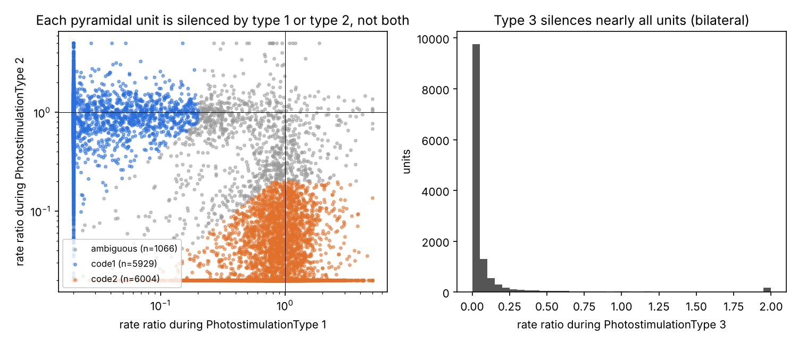

# callosal-dims

What does the corpus callosum carry? Separating interhemispheric communication from common drive
with unilateral silencing in mouse ALM, toward the minimal specification of a callosal BMI.

## Author

**Lan Zhenlin (藍振臨) — [@Nzm3915](https://github.com/Nzm3915)**, Electrical & Electronic Engineering, Korea University.

Project lead. Turned a proposal for a callosal brain–machine interface (Watanabe, *意識の脳科学*, 2024) into a
measurable engineering question — *what is the minimal specification of the link between two hemispheres?* —
and drove the research end to end: set the goals of each phase, chose which questions and hypotheses to pursue
and which to drop, selected and supplied the literature (including the book chapters behind the project),
proposed the quantum-brain hypothesis that docs/03 decomposes and tests, and carried the results into the
follow-up master's plan. Analysis code was written with an AI pair-programmer (Claude Code) under his direction
and review.

**Highlights**

- Recovered the hemisphere labels that the public data set does not record (Phase 0), then showed on 133 sessions
  / 39 mice that the directions along which the two hemispheres co-fluctuate carry only 14% of what one hemisphere
  actually sends the other (Phase 2).
- A virtual BMI fitted to the data: ~3 dimensions, ≤100 ms, ~90 bit/s reproduce the interhemispheric influence —
  but only when calibrated with perturbation data; links learned from normal activity predict nothing (Phase 3).
- Re-implemented DLAG (Gokcen et al. 2022) in PyTorch with exact-gradient marginal-likelihood fitting, and used it
  to test whether the best correlation-based method can recover the causal channel (Phase 6).
- Tested a dozen mechanistic hypotheses with pre-stated failure criteria (gates, attractors, ramping input, partner
  loss, inhibitory gain, circuit models); found that the state dependence of the callosal effect is partly explained
  by single-neuron gain loss (Phase 6–7).
- For the quantum-brain project, bounded the radical-pair route for the xenon isotope effect with a spin-dynamics
  model and an all-electron DFT estimate of the ¹²⁹Xe–radical hyperfine coupling (`quantum/`): ~1–2 mT next to a
  localised radical, but only 0.1–0.2 mT for the delocalised π radicals biology offers, too weak for the reported
  effect.
- Ran a self-auditing loop over all results (mouse-level statistics, unbiased ceilings, null models for each claim)
  and published the corrections it forced ([docs/00_review_log.md](docs/00_review_log.md)).

## Documents (Japanese)

- [docs/01_mouse_callosal_dims.md](docs/01_mouse_callosal_dims.md) — background, questions, phases and results of this project
- [docs/03_quantum_brain.md](docs/03_quantum_brain.md) — the quantum-brain hypothesis decomposed and tested, and a cell-level experiment (xenon / lithium isotopes) designed to settle the rest
- [docs/00_review_log.md](docs/00_review_log.md) — self-improvement loop: what was doubted, how it was checked, and which conclusions were corrected
- Follow-up master's research plan (split-brain world models): [Nzm3915/split-brain-world-models](https://github.com/Nzm3915/split-brain-world-models)

Data: [DANDI 000894](https://dandiarchive.org/dandiset/000894) — simultaneous bilateral ALM recordings
with unilateral / bilateral photoinhibition (Chen, Kang, Lindsey, Druckmann & Li, *Cell* 2021).

## Phase 0 — recover hemisphere labels and photostimulation codes

The NWB files list a single 64-channel electrode table with location "Left ALM, Right ALM", and the
trial table codes photoinhibition only as `PhotostimulationType` 0–3. Phase 0 recovers both from the
data: unilateral photoinhibition (VGAT-ChR2 / PV-ReaChR) silences pyramidal neurons only in the
illuminated hemisphere, so the code that silences a unit tells which hemisphere it belongs to.

```
pip install -r requirements.txt
python phase0/phase0_labels.py results/sessions      # streams spike times only (no 270 GB download)
python phase0/phase0_classify.py results/sessions/ALL.csv results
```

Window: 0.10–0.70 s after pole-out (= delay onset). The laser runs from pole-out for 0.8 s, the
last 0.2 s being a linear ramp-down. Pole-out is 1.87 s after trial start in 67 sessions and 2.87 s
in the other 66, so the window is aligned per trial.

### Results (133 sessions, 39 mice, 19,443 units)



| Finding | Evidence |
| --- | --- |
| Type 3 = bilateral photoinhibition | Laser peak power 13.7 mW vs 4.43 mW for types 1/2 (8-site galvo scanning); 93.9% of pyramidal units drop below 30% of control rate |
| Types 1 and 2 = the two unilateral conditions | 11,933 of 12,999 pyramidal units (≥1 Hz) are silenced (<20% of control) by exactly one of them, at least 4x more than by the other; 5,929 vs 6,004 |
| Units can be assigned to a hemisphere | Median rate ratio: code-1 units 0.00 under type 1 vs 0.88 under type 2; code-2 units 0.88 vs 0.005 |
| The electrode index does **not** identify the hemisphere | Electrode indices of the two groups overlap in every session (0 of 133 cleanly separated); the NWB electrode table has 64 rows for two 64-ch probes |
| Fast-spiking units behave as expected for activated inhibitory cells | Median rate ratio 3.05 under bilateral photoinhibition |
| Enough units per hemisphere for population analyses | Median 42–43 labeled units per hemisphere per session; 116 of 133 sessions have ≥20 in each |

Which code is *left*: the laser-site metadata lists the coordinates in the order (AP 2.5, ML −1.5),
(AP 2.5, ML +1.5) and the location "left ALM right ALM", which suggests type 1 = left ALM and
type 2 = right ALM. This is not yet confirmed independently. The planned analyses are symmetric
in the two hemispheres, so they do not depend on it.

## Phase 1 — reproduce Chen et al. 2021 Fig. 1, and look at error trials

```
python phase1/cache_counts.py CACHE_DIR                      # 50-ms spike counts aligned to the go cue (~110 MB)
python phase1/phase1_cd.py CACHE_DIR results/units_labeled.csv results/phase1
python phase1/phase1_plot.py results/phase1
```

Choice decoder (CD) per hemisphere = mean over the delay of (mean rate on "lick right" − "lick left" correct
trials), as in Chen et al.; 400-ms windows; 2-fold cross-validation so every correct trial is projected with a
CD that did not see it. Endpoint = last 400 ms before the go cue. Control trials only (no photostimulation,
no early lick, normal 1.7-s delay). Only Phase-0-labeled pyramidal units (median 33 in the smaller hemisphere;
Chen et al. averaged 71 neurons per hemisphere).


| Finding | Value (133 sessions) |
| --- | --- |
| Endpoints correlate between hemispheres within a trial type (Fig. 1G) | Spearman ρ 0.26 ("lick right"), 0.27 ("lick left"), 0.55 (both types); shuffled ≈ 0; within-type vs shuffled p = 7e-20 |
| The two hemispheres predict the same choice (Fig. 1H) | 74% of held-out correct trials; each hemisphere predicts the lick on 80–81% |
| The shortfall versus Chen et al. is explained by neuron count | ρ and agreement rise with the number of labeled units (Spearman 0.54, p = 3e-11); sessions with ≥ 60 units in both hemispheres: agreement 83%, ≥ 80 units: 89% |
| The correlation rises over the trial (Fig. S1H) | within-type ρ 0.14 before the sample epoch → 0.28 in the late delay → 0.07 after the go cue |
| The pre-sample correlation is not slow drift across the session | removing a ±10-trial running mean leaves it at 0.13 |
| **New:** on error trials the hemispheres make the same mistake more often than chance | agreement 61% vs 53% expected if independent given the trial type (p = 8e-12, 5,833 error trials); both predict the wrong (actual) lick on 38% of errors, both the instructed side on 23% |

Reading: about half of the late-delay correlation (ρ ≈ 0.14 of 0.28) is already present before the stimulus,
i.e. it is shared fluctuation that is not about the choice — a candidate for common input such as arousal
(McDonnell et al. 2026). Separating that part from what one hemisphere actually sends the other is Phase 2.

## Phase 2 — receiving subspace versus correlated subspace

```
python phase2/phase2_subspaces.py CACHE_DIR results/units_labeled.csv results/phase2
python phase2/phase2_plot.py results/phase2
```

Receiving response of hemisphere B to silencing A: Δ_B(t, c) = mean(B | silence A, c) − mean(B | control, c),
100-ms bins, z-scored per unit, separately for the laser epoch (first 0.8 s of the delay) and the rest of the
delay; the sample epoch (laser off) is a negative control. Candidate subspaces of B are estimated on a separate
third of the control trials. Overlap is measured without noise bias as
f(S) = ⟨PΔ₁, PΔ₂⟩ / ⟨Δ₁, Δ₂⟩ with Δ₁, Δ₂ from disjoint trial halves (1 = all of the reproducible response lies in S,
k/n = chance). The receiving subspace's own ceiling uses directions from yet another third of the trials.


| Finding | Median of 266 hemisphere pairs |
| --- | --- |
| Silencing one side evokes a reproducible response in the other; none when the laser is off | split-half reliability 0.40 (laser on), 0.27 (after), 0.00 (sample epoch) |
| The response is low-dimensional | own top 1 / 3 / 5 directions capture 49% / 61% / 66% (conservative); random 3 dims: 7% |
| **The correlated subspace holds little of it** | 3 dims: 14% (2× chance, < ¼ of the receiving subspace); receiving > correlated in nearly every pair, p = 4e-42 |
| …no more than B's own largest fluctuations or its task trajectories | 15% and 17% (3 dims) |
| The correlated subspace is real but small | held-out R² of B's fluctuations from A: 3.4% (rank 3), > 0 in 97% of pairs |
| Most of the response is not about the choice | trial-type-dependent part: 4% (laser on) – 8% (after); CD holds 38% of that part, 5% of the whole |
| It is not a uniform drop | uniform direction 5%; 62% of units go down, 38% go up |
| The direction changes between the laser epoch and recovery | laser-on subspace (3 dims) holds 15% of the later response vs 52% for its own |

Reading: what one hemisphere contributes to the other (its loss under silencing) mostly lies outside the
directions in which the two hemispheres co-fluctuate. A link that copied the correlated subspace would reproduce
about one seventh of it.

Limitations: the receiving ceiling is underestimated (a third of the trials); the correlated subspace is defined
from within-trial residuals in 100-ms bins (pCCA-FA, McDonnell et al. 2026, not yet run); a small direct effect
of scattered light on the other hemisphere cannot be fully excluded.

## Phase 3 — the minimal virtual callosal link

```
python phase3/phase3_link.py CACHE_DIR results/units_labeled.csv results/phase2/phase2_pairs.csv results/phase3
python phase3/phase3_plot.py results/phase3
```

Linear model of hemisphere B in its top 20 PCs, 100-ms steps:
y_B(t) = M y_B(t−1) + o(t, c) + g(t) W y_A(t−L), rank(W) ≤ d. Trained on half of the trials, tested on the other
half by running the model forward from delay onset driven only by A's observed activity, and scoring how well it
predicts B's response to silencing A (noise-corrected R², denominator from two disjoint halves of the test trials).
Bit rate = d × bits × 10 Hz after uniform quantisation of the d link signals.


| Finding | Median of 266 hemisphere pairs |
| --- | --- |
| **A link learned from control trials alone does not predict the silencing response** | R² ≈ 0, and worse with more dimensions (−0.16 at d = 10) |
| In control trials the link is nearly invisible | one-step R² gain 0.005, versus a gain of 0.32 in the silencing response |
| Trained with silencing trials, the full-rank link predicts the response | R² 0.38 (laser on), 0.29 (after) |
| **The link should run along the receiving subspace** | 3 dims along it: 0.44, better than full rank (p = 2e-14); 3 best-predicting dims: 0.20 (difference 0.21, p = 3e-40) |
| The link must be fast | delay 100 / 200 / 300 ms: 0.38 / 0.29 / 0.22 |
| **Gating does not help (H3/H4 not supported)** | two-state gate (Chen et al.) = fixed (p = 0.31); precision gate slightly worse (−0.01), weakest κ always chosen |
| **About 90 bit/s suffices** | receiving subspace, 3 dims × 3 bits × 10 Hz: 0.43 (unquantised 0.44); 2 bits: −0.03 |

Reading: correlations alone cannot calibrate a callosal link — the link is almost invisible in normal trials;
perturbation data are required. A link of 3 dimensions along the receiving subspace, ≤ 100 ms delay and ~90 bit/s
reproduced the silencing response as well as a full-rank link, without any gating. (This is for ~40 recorded
neurons per side summarised by 20 PCs, not an estimate of the capacity of the whole corpus callosum.)

Limitations: linear model (no attractor dynamics); unknown ceiling for R²; recovery after the laser is captured
less well (0.29) than the laser epoch. Nonlinear models and per-animal analyses: Phase 4.

## Phase 4 — individual differences, and gating revisited with nonlinear models

```
python phase4/phase4_modularity_gating.py CACHE_DIR results/units_labeled.csv results/phase4
python phase4/phase4_nonlinear.py CACHE_DIR results/units_labeled.csv results/phase4   # torch (CPU)
python phase4/phase4_plot.py results
```

1. **Modularity** (Chen et al.): fraction of selectivity a hemisphere keeps while the other is silenced; recovery:
   fraction regained at the end of the delay. Delay-selective labeled units, Chen's exclusion criteria.
2. **Model-free gating test**: per hemisphere pair, B's choice confidence during the laser regressed on both
   hemispheres' confidence just before the laser, in control and silencing trials:
   y = b0 + b1 cB + b2 cA + stim·(c0 + c1 cB + c2 cA). H4 predicts c1 > 0 and c2 < 0.
3. **Nonlinear model**: Phase 3 model + an MLP for B's own dynamics + a learned gate (from B's state and A's
   activity) or a precision gate (κ, β learned); trained one step ahead with early stopping, tested free-running.


| Finding | Value |
| --- | --- |
| Modular hemispheres recover better (Chen Fig. 4H) | ρ = 0.29, p = 5e-6 (247 pairs, 39 mice) |
| **Which hemisphere drives is a trait of the mouse** | code-1 minus code-2 modularity differs across mice (25 mice with ≥ 3 sessions, ANOVA p = 9e-7); no overall side bias (p = 0.19) |
| The level of modularity is only moderately individual | ~23% of its variance is between mice |
| The Phase 3 specification does not depend on modularity | ρ = 0.06 with the 3-D receiving-subspace link's R² |
| Not reproduced: modular sessions less correlated (Chen) | ρ = 0.04 with the Phase 1 correlation |
| Silencing A lowers B's choice confidence | c0 = −0.29 (261 pairs, p = 5e-41) |
| **…more, not less, when B was already confident (against H4)** | c1 = −0.11 (p = 2e-18); but less than a proportional shrinkage would give (−0.29; difference p = 9e-24) |
| …and more when A was confident (H4's direction) | c2 = −0.05 (p = 1e-7), about what a proportional loss predicts |
| Nonlinear dynamics do not improve the silencing response | full-rank fixed link: linear 0.35, nonlinear 0.36 (n.s.) |
| **Gates do not help** | d = 3: fixed / learned / precision 0.22 / 0.22 / 0.22; d = 20: learned gate +0.016 (laser on), −0.003 after |
| The precision gate collapses to a constant | median κ = 0.05; across-trial SD of the gate 0.014 |
| **No model, gated or not, reproduces the choice-axis effect** | data c0 = −0.19, c1 = −0.08 vs models c0 ≈ −0.04 to −0.07, c1 ≈ −0.03 to −0.05 (PC / 100-ms representation) |

Reading: the bulk of what one hemisphere contributes to the other is reproduced by a fixed low-dimensional link,
with no gating and no nonlinearity. The small choice-axis component (5% of the response) shows a state dependence
that none of the models capture — plausibly what Chen et al. described as state-dependent gating, but this data
cannot tell gating apart from the receiving hemisphere's own choice attractor. Which side leads is an individual
trait, so a callosal link would need per-animal calibration.

## Phase 5 — mechanisms, with approaches from the literature

```
python phase5/phase5_mechanisms.py CACHE_DIR results/units_labeled.csv results/phase5   # rotation, behaviour, 1-D drift
python phase5/phase5_choice_axis.py CACHE_DIR results/units_labeled.csv results/phase5  # choice-axis models
python phase5/phase5_latency.py CACHE_DIR results                                        # FS vs pyramidal time course
python phase5/phase5_plot.py results
```


| Question (approach) | Finding |
| --- | --- |
| Which cells receive the callosal input? (cf. Wang et al. 2023, ACA callosal → PV loop) | Fast-spiking units (assigned to a hemisphere by their activation under that hemisphere's light) drop to 0.55 of control when the *other* hemisphere is silenced, pyramidal units to 0.87 (414 vs 9,785 units, p = 2e-41); 70% vs 42% drop by > 20% |
| In what order? | FS and decreasing pyramidal units drop within the first 50 ms, together with the silenced side; increasing pyramidal units rise 50–150 ms later (disinhibition). After the laser, FS on the other side overshoot by ~40% (rebound from the silenced side) |
| Does the channel rotate? (Javadzadeh & Hofer 2022) | Within the laser epoch the receiving direction changes with τ ≈ 0.8 s, like B's own activity (0.9 s); after the laser τ ≈ 1.2 s. Laser-epoch and post-laser directions are orthogonal (cosine −0.01): the channel switches with the kind of input (loss vs rebound), it does not rotate on a 100-ms scale |
| Does the receiving response matter for behaviour? | Performance drops 81.5% → 75.6%; the drop follows the modularity of the remaining hemisphere (ρ = −0.30, p = 3e-6) but not the size of the receiving response (ρ = 0.06, p = 0.33). B's laser-epoch choice confidence predicts correct licks (AUC 0.61; silenced A 0.53) |
| Is the choice-axis state dependence an attractor or a gate? (Inagaki et al. 2019 drift analysis; Finkelstein et al. 2021) | No: 1-D choice-axis models with B alone (linear or cubic/attractor), a fixed link, a precision gate or gate + attractor all give c1 ≈ 0 (data −0.10). Links fitted on these data are ~0 (median w = 0.01): on the choice axis too, the link is invisible in normal trials |

Reading: the callosal input lands heavily on inhibitory cells; most of what it does to the other hemisphere is
not what matters for behaviour; and the choice-axis state dependence is neither a precision gate nor a simple
attractor — a change of gain (via inhibition) is the remaining candidate. Next steps and the reading list are in
docs/01 sections 6–7.

## Phase 6 — the remaining puzzle, with the literature's tests and a new hypothesis

```
python phase6/phase6_modes.py CACHE_DIR results/units_labeled.csv results/phase6       # 6-1 modes (Finkelstein, Inagaki, Economo)
python phase6/phase6_ramp.py CACHE_DIR results/units_labeled.csv results/phase6        # 6-2 ramping mode as gain carrier
python phase6/phase6_partner.py CACHE_DIR results/units_labeled.csv results/phase6     # 6-2b partner loss (errors in variables)
python phase6/phase6_fsgain.py CACHE_DIR results results/phase6                        # 6-3 FS rate as gain carrier (B2')
python phase6/phase6_neurongain.py CACHE_DIR results/units_labeled.csv results/phase6  # 6-4 single-neuron gain (new)
python phase6/phase6_dlag.py CACHE_DIR results/units_labeled.csv results/phase6        # 6-5 DLAG (PyTorch re-implementation)
python phase6/phase6_dlag_analysis.py CACHE_DIR results
python phase6/phase6_rewrite.py CACHE_DIR results/units_labeled.csv results/phase6     # 6-6 is A rewritten from B?
python hypotheses/h5b_circuit.py results                                               # B5' circuit with heterogeneity + adaptation
python phase6/phase6_plot.py results
```


| Question | Answer |
| --- | --- |
| Which of the receiver's modes carries the callosal response? (choice / ramping mode, Finkelstein 2021, Inagaki 2019; early / late / go CDs, Economo 2018) | None: the top receiving direction holds 51% of the reliable response (unbiased three-way estimate; 74% with the biased two-way estimate); choice mode 4.9%, ramping mode 5.8–8.0%, all three non-selective modes 19%, Economo's CDs 2–4% (random 1-D: 2.4%). B's own variance along it is 1.26× a random direction |
| Does a stronger ramping mode protect the plan (Finkelstein Fig. 5f)? | No: stim × ramp = −0.006 (p = 0.88); behavioural error excess flat across ramp tertiles; c1 unchanged (−0.121 → −0.119) |
| Is c1 an errors-in-variables artefact of losing a correlated partner? | No: measuring A better (0.4 → 1.2 s) leaves c1 at −0.12 to −0.13 |
| Is B's fast-spiking rate the gain carrier (B2')? | No: FS drop to 0.62× but do not modulate persistence (f = −0.012, p = 0.68); predicted c1 = +0.006 vs −0.132 observed |
| **New: single-neuron gain** — does each neuron lose the state it carries in proportion to its rate drop? | **Partly**: suppressed neurons lose the state they carry roughly in proportion to their rate (11,708 units, cross-validated); the parameter-free prediction explains 42% of c1 pooled over pairs (95% CI 19–139%, bootstrap over mice; 77% with one recurrent pass) |
| Is the silenced hemisphere rewritten from the other one? | No: with both predictors taken before the laser, A's end state depends on its own and on B's earlier state with unchanged weights (Δ +0.007, p = 0.88; Δ +0.024, p = 0.13). (An earlier version used B's laser-window state, which the laser degrades; corrected in Phase 7.) |
| Circuit model with heterogeneous callosal input and adaptation (B5') | Heterogeneity is needed to get both up and down units (89%/1% without it), but over 5 network seeds it gives 31%/49% vs data 42%/20% (the first seed's 52%/28% was luck). Adaptation gives a rebound of the right sign (+0.23) but not jointly with the mean time courses (data +0.40) |
| Does DLAG (re-implemented in PyTorch; delays and dimensionality recovered on synthetic data) find the callosal channel in normal trials? (B4') | It finds across-hemisphere latents in 88% of 126 sessions, 56% with significant delays (median 30 ms). But they hold 0.20 of the silencing response (receiving subspace of the same size: 0.89; random 0.07), and the inferred direction of flow does not match the causal asymmetry measured by silencing (ρ = -0.03, p = 0.74) |

## Phase 7 — self-improvement loop: audits and corrections

```
python phase7/phase7_loop.py CACHE_DIR results/units_labeled.csv results/phase7        # round-trip hypothesis (ratio estimator + coupled model)
python phase7/phase7_gain_pooled.py results                                            # pooled single-neuron gain with bootstrap CIs
python phase7/phase7_audit.py CACHE_DIR results                                        # mouse-level statistics, rewrite test, unit selection
python phase7/phase7_committee_test.py CACHE_DIR results/units_labeled.csv results/phase7  # committee vs single-driver null
python phase7/phase7_circuit_seeds.py results; python phase7/phase7_circuit_robust.py     # circuit robustness to network seeds
python phase7/phase7_rampdown.py CACHE_DIR results/units_labeled.csv results/phase7  # gain account within the same neurons (end of the laser)
python phase7/phase7_rampdown_mean.py CACHE_DIR results/units_labeled.csv results/phase7  # mean loss in the same windows
python phase7/phase7_plot.py results
```


| Audit | Outcome |
| --- | --- |
| Is the rest of c1 the loss of an interhemispheric round trip (B→A→B)? | No. Calibrating the link from c2 predicts c1 = −0.001 (mouse-level p = 0.56); a coupled two-hemisphere model fitted with silencing trials finds couplings of ~0.02 and does not even reproduce c0. Calibrating from c0 instead is inconsistent with c2 (predicts −0.20 vs −0.05) |
| Pseudo-replication (pairs from the same session/mouse) | Every headline effect survives one-value-per-mouse tests (39 mice; most with all 39 in the same direction) |
| Biased ceilings | The top receiving direction and the DLAG ceiling were estimated with the same trials used to score them. Unbiased three-way estimates: 0.51 (1 dim), 0.64 (DLAG's k); conclusions unchanged |
| Committee readout (B1) | Disattenuated inter-hemispheric correlation of the choice state is ≥ 0.9; a single-driver null with the measured reliabilities reproduces the 'more confident side wins' excess (+0.039 vs observed +0.025). B1 downgraded to unresolved |
| Circuit model (B5') | Not robust to network seeds; see Phase 6 table |
| Gain account within the same neurons (B8) | Moving the response window through the end of the laser: rates recover within 0.1 s, the state dependence ~0.1 s later, the mean loss of B's choice signal only slowly (half left after 0.5 s). The state dependence is present only while gain is reduced — not the tail of a displaced state. The simple gain formula explains ~40% of its size. B8 kept as partial |

## Conclusion

| Specification of a callosal link (ALM, delay epoch) | Result |
| --- | --- |
| What to carry | the receiving subspace: ~3 dimensions, not the correlated subspace (14% overlap) and not mainly the choice axis (5%) |
| How to learn it | from perturbation data; links fitted to normal activity alone predict nothing |
| Delay | ≤ 100 ms |
| Bit rate | ~90 bit/s (3 dims × 3 bits × 10 Hz), for ~40 neurons per side |
| Gating | not needed for the bulk of the response; the choice-axis state dependence is not a gate, attractor, ramp or inhibitory-rate gain — single-neuron gain loss explains ~40% (CI up to all of it), so a link must preserve each neuron's operating point, not just the mean rate |
| Where it acts | heavily on inhibitory (fast-spiking) cells, within 50 ms |
| What to evaluate it by | preserving the choice axis, not reproducing the whole response (which does not predict behaviour) |
| Individual calibration | needed: the leading hemisphere is a trait of the animal |
| Memory | after silencing, a hemisphere returns to its own plan rather than copying the other: the short-term memory survives outside spiking |
