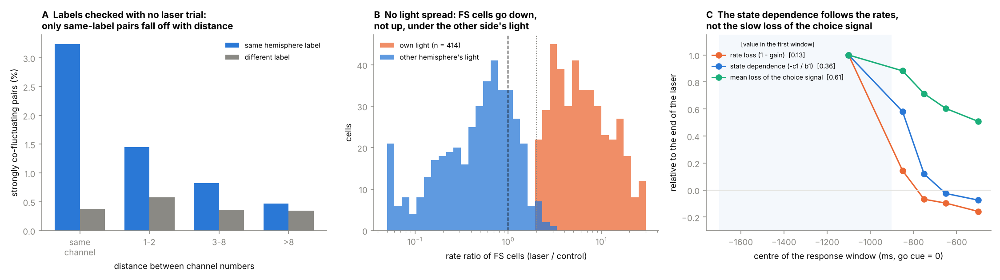
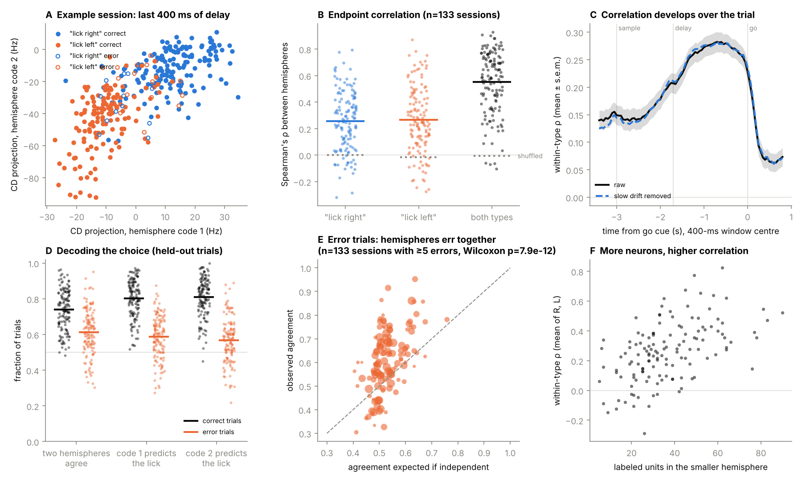
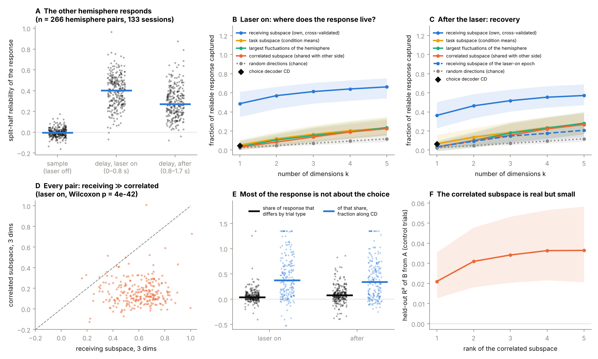
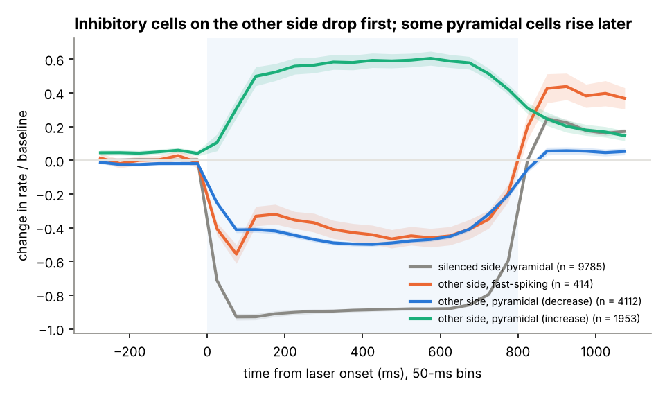
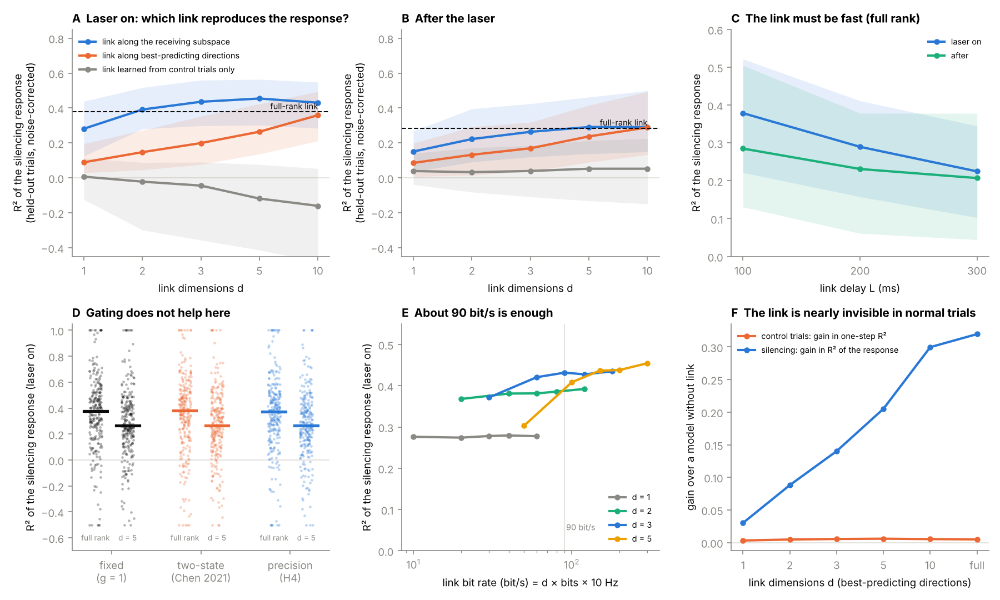
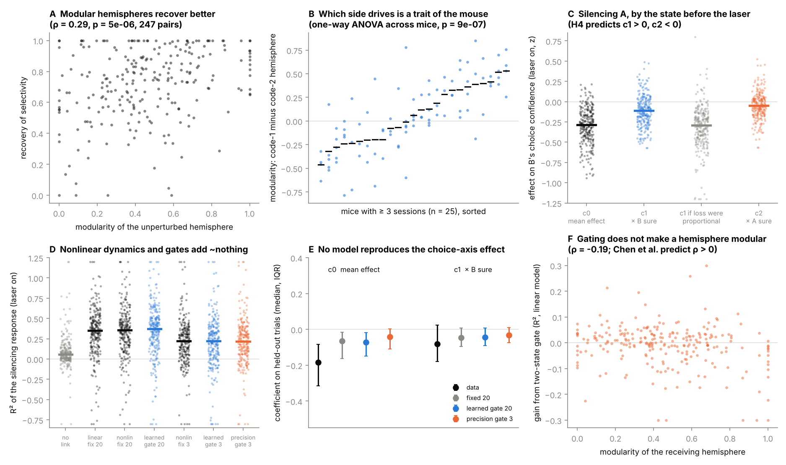
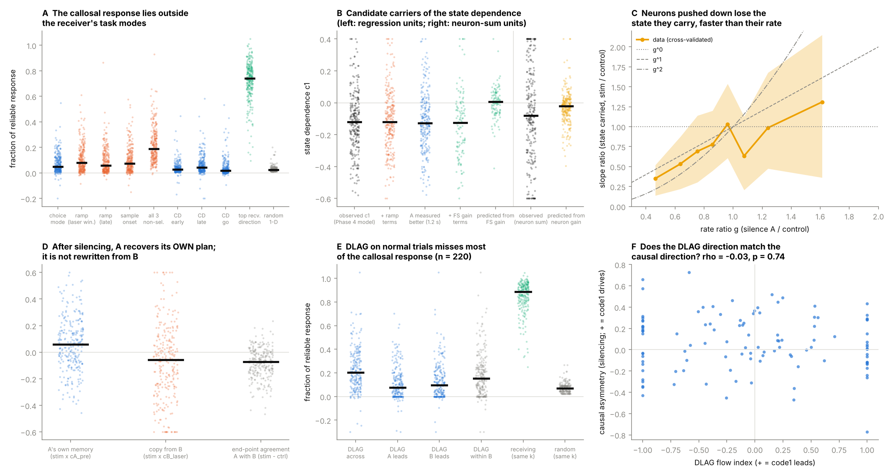
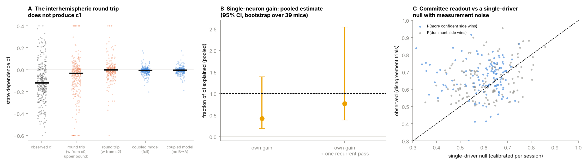
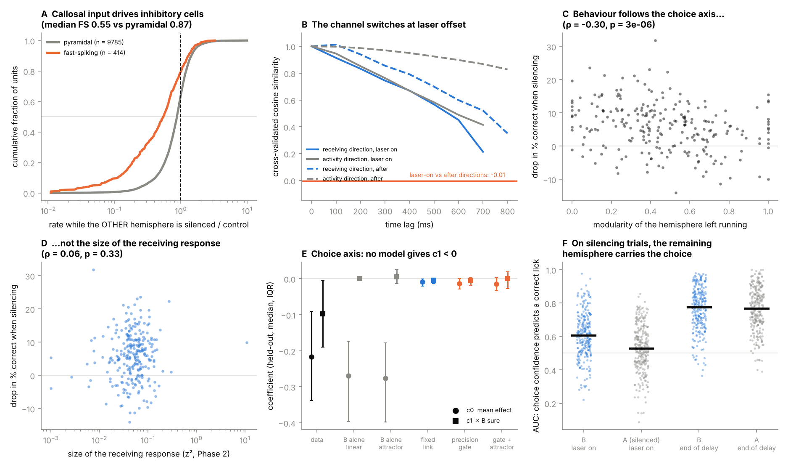
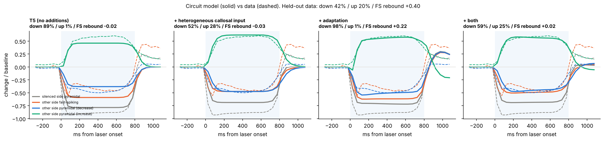

# 01 脳梁は何を運んでいるのか ― マウスの両半球記録と片側抑制から、脳梁BMIの最小仕様を測る

> **この文書の位置づけ**：三つのプロジェクトの一つ目。02（分離脳ワールドモデル）は、ここで測った仕様を人工系で確かめる計画、
> 03（量子脳の細胞実験）は、ここで分かった「古典モデルで足りる」ことの外側を細胞の化学で確かめる計画である。
> 予備知識のない人でも追えるように書いた。数式には必ず日本語の意味を添える。
> 結論を途中で訂正した箇所は、訂正前の主張と理由を [00_review_log.md](00_review_log.md) に残してある。
> コードと結果ファイルの対応は9節。投稿を想定した自己査読の指摘と対応は [01_referee_report.md](01_referee_report.md) にある。

---

## 0. 一枚でいうと

左右の大脳半球は、脳梁（のうりょう）という神経の束でつながっている。東京大学の渡邉正峰准教授は、片方の半球を機械に置き換え、脳梁の代わりにBMI（脳と機械をつなぐ装置）で生体の半球とつなぐ「人工意識の主観テスト」を構想している（渡辺『意識の脳科学』2024）。このテストが成り立つには、BMIが本物の脳梁と同じ働きをしなければならない。

では、脳梁は実際に**何を、どれだけ、どんな規則で**運んでいるのか。
マウスの公開データ（DANDI 000894：左右の運動準備野 ALM を同時に記録し、片側を光で一時的に止めた実験、133セッション・39匹）で、それを測った。

**中心の問い**：左右の半球で「一緒に揺れている成分」と、片側を失ったときに反対側で「変わる成分」は同じか。違うなら、相関をまねるだけのBMIでは本物の脳梁の代わりにならない。

**用語**：本文の「脳梁の入力」「受信の反応」は、正確には「片側（A）を止めたときに失われる、反対側（B）への影響の総体」を指す。視床などを経由する経路の分も含むが、脳梁を切ると片側の回復が消えること（Li ら 2016）から、主には脳梁を通ると考える。BMI に求める性質は「片側を失ったときに失われるものを再現する」ことなので、この定義のほうが仕様の議論には直接に合う。

**分かったこと**（統計はすべてマウスを単位にしても確かめた）：

1. **相関は通信ではない。** 左右が一緒に揺れる方向は、片側を止めたときの反対側の反応の14%しか含まない（受け手自身がふだん揺れる方向も15%で、反応はふだんの揺れの外に入る）。遅れと向きまで推定する最良の相関の方法（DLAG）を全セッションにかけても 0.20 で（上限は 0.64）、推定された信号の向きは因果の向きと無関係だった。
2. **リンクは介入のデータで校正しなければならない。** 普通の試行だけから学んだリンクは、片側を失ったときの反応を予測できない。止めた試行で校正すると、**受信の方向に沿った3次元・100ミリ秒以内・約90 bit/s** のリンクで再現でき、状態でリンクの強さを変えるゲートは要らなかった。3次元という数は、方向を4本目に増やしたときの上積みが、でたらめな方向を1本足したときと区別できなくなることから決めた。
3. **脳梁の入力の大部分は、受け手の課題のモードの外に入る。** 反応の約半分〜4分の3が一つの方向に集まるが、それは選択の軸（5%）でもランプ（時間の合図、8%）でもない。最初に強く影響を受けるのは速く発火する抑制性細胞で、その後に一部の錐体細胞が上がる。
4. **行動に効くのは、反応の大部分ではなく選択軸の小さな成分である。** 反応の大きさは成績の低下と無関係だった。
5. **止める前の状態で影響が変わる性質（状態依存性）の一部は、ニューロン一つずつの利得の低下で説明できる。** ゲート・アトラクター・ランプ・相手の測り損ね・半球間の往復・抑制性細胞の発火率のどれでも説明できなかった。発火を下げられた細胞ほど、運ぶ状態の情報を失う。この効果で、状態依存性の 42%（95%区間 19〜139%）を、止めた試行に合わせずに予測できた。光が終わると、状態依存性は発火率の回復から約 0.1 秒で消え、0.5 秒以上残る平均の落ち込みとは別の速さで動く。状態依存性は利得が下がっている間だけ現れる。
6. **左右はほぼ同じ選択の状態を持つが、別々に保てる。** 測定の雑音を除くと、左右の選択の状態の相関は0.9以上だった。それでも片側を止めたときの成績の低下は6ポイントだけで、止められた側は相手から書き戻されるのではなく、止める前と同じ配分で自分と相手の状態に戻った。
7. **どちらの半球が主導するかは、マウスごとの性質である。** BMIは個体ごとに校正が要る。

**脳梁BMIの最小仕様（ALM、遅延期）**：

| 仕様 | 結果 |
| --- | --- |
| 運ぶもの | 受信の方向（約3次元）。相関の方向（14%）でも、選択の軸だけ（5%）でもない |
| 決め方 | 片側を止めた応答による校正。普通の活動の相関からは決められない |
| 遅延 | 100 ms 以内（200 ms で再現度は4分の3に落ちる） |
| ビットレート | 約90 bit/s（3次元×3ビット×10 Hz、片側40個ほどのニューロンの表現で） |
| ゲート | 要らない |
| 書き込む先 | 抑制性細胞を含めること。興奮性の経路だけでは釣り合いが崩れる |
| 評価の物差し | 反応全体の再現度ではなく、選択の情報が保たれたか |
| 守るべきもの | 平均の発火ではなく、ニューロン一つずつの発火の水準（利得） |
| 校正 | 個体ごと |

---

## 1. 前提知識

### 1.1 ニューロン、スパイク、発火率

ニューロンは「スパイク」と呼ばれる短い電気パルスで情報を伝える。一定時間 $T$ のあいだに出たスパイクの数 $n$ を数え、発火率として扱う。

$$
r=\frac{n}{T}\quad[\text{spikes/s}]
$$

### 1.2 集団の活動は「高次元空間の一点」

同時に記録した $N$ 個のニューロンの発火率を並べると、$N$ 次元のベクトル $\mathbf r(t)$ になる。時間とともにこの点が動き、軌跡を描く。
オーケストラの全楽器の音量を並べたものが「その瞬間の曲の状態」になるのと同じだ。100個のニューロンがあっても、実際の変動は数個の方向にしか広がっていないことが多い。この「意味のある方向」が張る領域を**部分空間**と呼ぶ。

### 1.3 ALM と遅延反応課題

ALM（anterior lateral motor cortex）は「これから左右どちらに舌を出すか」を準備する領域である。
課題では、マウスがヒゲで棒の位置を感じ（サンプル期、約1.3秒）、約1.7秒待ち（遅延期）、合図の後に左右どちらかをなめて答える。遅延期のあいだ、ALM は「左／右」の情報を持ち続ける。これを**準備活動**（短期記憶）と呼ぶ。

### 1.4 選択軸（coding direction, CD）

「右をなめる試行」と「左をなめる試行」の平均の差の方向である。

$$
\mathbf{cd}=\frac{\bar{\mathbf r}_{\rm R}-\bar{\mathbf r}_{\rm L}}{\lVert\bar{\mathbf r}_{\rm R}-\bar{\mathbf r}_{\rm L}\rVert},
\qquad x(t)=\mathbf{cd}^{\top}\mathbf r(t)
$$

$N$ 次元の活動をこの一本の軸に射影した値 $x(t)$ を見れば、「いま右寄りか左寄りか」が一つの数字で読める。本文では、境界からの距離を試行のばらつきで割った値を**確信度**と呼ぶ。

ALM の活動には、選択軸のほかに、左右に関係なく遅延期に高まっていく**ランプモード**がある。Finkelstein ら（2021）と Inagaki ら（2019）は、これを「もうすぐ動く」という時間の合図の入力と解釈した。この入力が二つの選択の谷（アトラクター）を引き離し、計画を揺らぎにくくするという。

### 1.5 光遺伝学による抑制

抑制性ニューロンに光で反応するタンパク質を持たせたマウスに青い光を当てると、抑制性ニューロンが一斉に働き、周囲の興奮性ニューロンがほぼ完全に黙る。
「ここを0.8秒だけ止めたら何が起きるか」という**因果**を問えるのが最大の利点だ。

### 1.6 相関と因果、共通入力

二人が同時に笑っていても、会話で笑ったのか、同じテレビを見て笑ったのかは区別できない。後者が**共通入力**だ。
左右の半球が一緒に揺れていても、互いに信号を送り合っているのか、同じ入力（覚醒度など）を受けているだけなのかは、相関からは分からない。片方の口をふさぐ（片側を止める）ことで初めて区別できる。

### 1.7 通信部分空間と低ランク回帰

領域Aの活動 $X$ から領域Bの活動 $Y$ を線形回帰で予測するとき、係数の行列 $B$ のランクを $d$ 以下に制限する。

$$
Y\approx XB,\qquad \operatorname{rank}(B)\le d
$$

$d$ を増やしても予測が良くならなくなる点が「実際に使われている通路の本数」になる。Semedo ら（2019）は、サルの V1→V2 の通信がわずか約2次元であることを示した。ただしこれは相関にもとづく推定で、因果は問えない。

---

## 2. 何が分かっていて、何が空いていたか

| 論文 | 分かっていること | 残っていた穴 |
| --- | --- | --- |
| Li ら 2016 *Nature* | 片側を止めても約0.5秒で選択の情報が戻る。脳梁を切ると戻らない | 片側しか記録していない |
| Chen ら 2021 *Cell* | 左右同時記録。状態依存の遮断。個体差（モジュール型／非対称型） | 半球間の影響を選択軸の1次元でしか見ていない |
| Semedo ら 2019 *Neuron* | 領域間の通信は少数次元を通る | 相関にもとづき、因果は問えない |
| McDonnell ら 2026 *Nat Commun* | サル前頭前野の左右の共有成分は多次元で、覚醒と連動する | 抑制実験がない |
| Gokcen ら 2022 *Nat Comput Sci* | DLAG：共有成分を、遅れと向きつきで分ける | 遅れの向きが因果の向きかは確かめられない |
| Gonzalez ら 2026 *Nature*（見直しで追加） | 海馬と脳梁膨大後部の通信部分空間を、第三の領域を統制した正準相関で同定。睡眠中のリプレイと対応する | 介入がなく、相関にもとづく。本研究の指摘がそのまま当てはまる |
| Finkelstein ら 2021 *Nat Neurosci*、Inagaki ら 2019 *Nature* | ランプの入力が選択のアトラクターを引き離し、計画を守る | 脳梁の入力が失われたときにも働くかは不明 |

**空白**：「左右で相関する方向」と「片側が壊れたときに反対側で変わる方向」を、同じデータで比べた研究はなかった。Chen の公開データ（DANDI 000894）で、この空白を埋めた。

---

## 3. 問いと仮説、最終の判定

| 仮説 | 内容 | 判定 |
| --- | --- | --- |
| H1 | 受信の方向は少数（1–3）で、選択軸を含む | 半分支持：少数に集まるが、選択軸はその5% |
| H2 | 相関の方向は受信の方向とずれている（共通入力が多い） | **支持**：相関の方向は受信の14%、DLAG でも 0.20 |
| H3 | 修復には、受け手の状態で強さを変えるゲートが要る | 棄却：固定のリンクで足りる |
| H4 | ゲートの強さは、両半球の確からしさ（精度）で決まる | 棄却：精度ゲートは一定に収束 |
| B1 | 二つの半球は「委員会」で、出口で確信度を足す | 未決着：確信度の高い側が勝つ傾向は、片方だけが決める模型でも出る（5.6） |
| B2' | 抑制性細胞の発火率が利得を決める | 棄却 |
| B5' | 細胞ごとにばらつく脳梁入力と順応で、反応の混ざりと反跳が出る | 部分的：混ざりは出るが割合は合わない。反跳は大きさが足りない |
| B6 | 光の後の反跳は回復を助ける | 棄却 |
| B7 | 主導する半球は行動の左右の偏りで決まる | 棄却 |
| B8 | 状態依存性は、ニューロンごとの利得の低下から生じる | **部分的に支持**：状態依存性の 42%（19〜139%）。光の終わりで、状態依存性は発火率の回復の約 0.1 秒後に消え、平均の落ち込み（0.5 秒以上残る）とは連動しない＝利得が下がっている間だけ現れる |
| B9 | 止められた半球は相手から書き戻される | 棄却 |
| R1 | 状態依存性は、半球間の往復（B→A→B）を失った分である | 棄却 |
| F1 | ランプが強いほど、片側を失っても計画が守られる（Finkelstein 型） | 棄却 |

量子脳に関わる仮説（Q1〜Q4）と、サンプリング仮説（旧 B3）は 03 に移した。

---

## 4. データと共通の方法

### 4.1 左右のラベルを復元する（Phase 0）

公開データのファイルには、各ニューロンが左右どちらの半球のものかが書かれていない。光抑制の種類も `PhotostimulationType` の 0〜3 の番号だけだ。
片側に光を当てると、その側の錐体細胞は黙るが、反対側はほとんど影響を受けない。そこでニューロンごとに「どの番号の光で黙るか」を調べた。電気を片方ずつ消して、どの電球が消えるかで配線を突き止めるのと同じ考え方だ。

| 分かったこと | 根拠（133セッション、39匹） |
| --- | --- |
| 番号3は両側の抑制 | レーザーの最大出力 13.7 mW（番号1・2は4.43 mW）。錐体細胞の93.9%が3割以下に落ちる |
| 番号1と2でニューロンが二つに分かれる | 1 Hz 以上の錐体細胞 12,999個のうち 92% が、片方の番号でだけ止まる（5,929 対 6,004） |
| ラベルの付かなかった細胞に、脳梁に強く依存する細胞が隠れていない | 付かなかった1,066個のうち、両方の光で止まるものは66個だけ。残りは反応の弱い細胞 |
| 解析に十分な数がある | 片側あたり中央値42個 |

番号1と2のどちらが左かは確かめていないが、解析は左右を対称に扱うので結論には影響しない。

**光を使わないラベルの検査**（見直しで追加、`phase7/phase7_label_validation.py`）：ラベルは光への反応で決めているので、循環の疑いがある。NWB の電極の表は座標が仮置きで、チャンネル番号は二本のプローブで重なるため、メタデータでは確かめられない。そこで、光のない対照試行だけで、細胞どうしの速いゆらぎの相関を調べた。同じプローブの近くにいる細胞ほど強く相関するはずだからだ。強く相関するペア（r > 0.1）の割合は、同じチャンネル番号どうしで、同じラベルなら 3.2%、違うラベルなら 0.37% だった。チャンネル番号が離れるほど相関が下がる性質は、同じラベルのペアにだけ現れた（違うラベルでは番号によらず約0.4%）。39匹中36匹で同じ向きだった（p = 1.5×10⁻⁷）。ラベルは光と独立な物理的な性質とも合っており、誤ったラベルは多くても1割に届かない程度と見積もれる。

**光の漏れの検査**：このマウスの光は抑制性細胞を活性化するので、光が反対側に漏れていれば、反対側の FS は A への光でも上がるはずだ。B 自身の光で 2 倍以上に上がることで同定した B の FS（414個）は、B 自身の光で中央値 5.8 倍に上がった。一方 A への光では中央値 0.55 倍に**下がり**、2 倍以上に上がったのは 1.4% だけだった。反対側の反応は光の漏れでは説明できない。

**行動の検査**：遅延期の早すぎるなめ（体の動きの粗い指標）は、対照 3.7%、片側を止めた試行 3.6% で変わらなかった（マウス単位 p = 0.57）。早すぎるなめのあった試行はすべての解析から除いた。

### 4.2 「再現する反応」の割合を測る量

片側（A）を止めたときの反対側（B）の反応を、時刻 $t$ と試行の種類 $c$（右／左）ごとに求める。

$$
\Delta_B(t,c)=\mathbb E\left[\mathbf r_B(t)\mid A\text{を止めた},c\right]-\mathbb E\left[\mathbf r_B(t)\mid\text{対照},c\right]
$$

反応のうち、ある部分空間 $S$（射影 $P$）に入る割合は、試行を二つに分けて独立に求めた $\Delta_1,\Delta_2$ の内積で測る。

$$
f(S)=\frac{\langle P\Delta_1,P\Delta_2\rangle}{\langle\Delta_1,\Delta_2\rangle}
$$

二つの半分の雑音は互いに独立なので、内積をとると平均で消え、再現する部分だけが残る。$f=1$ なら反応のすべてが $S$ に入り、$k/n$ ならでたらめと同じだ。
（たとえ：同じ曲を二回録音し、両方に共通して入っている音だけを取り出して、それがどの楽器の音域に入っているかを見る。）

**注意（見直しで追加）**：$S$ そのものを $\Delta_1$ から求めると、$\Delta_1$ の雑音と $S$ がそろってしまい、$f$ が上に偏る。そこで「方向を推定する3分の1」と「評価する二つの3分の1」を分けた**偏りのない推定**も必ず併記する（試行が減るので控えめな値になる）。

### 4.3 状態依存性を測る回帰

試行ごとに、光の直前400ミリ秒の両半球の確信度（$c_B, c_A$）を測る。光の間のBの確信度 $y$ を、普通の試行と止めた試行をまとめて次の式で説明する。

$$
y=b_0+b_1c_B+b_2c_A+\text{stim}\times\big(c_0+c_1c_B+c_2c_A\big)
$$

普通の試行が「もともとの関係」（確信が続く傾向）を与えるので、Aを止めた効果は stim との積の項だけに表れる。$c_0$ は平均の落ち込み、$c_1$ は「止める前にBが確信していたほど落ち込みがどう変わるか」で、本文ではこれを**状態依存性**と呼ぶ。

### 4.4 統計の単位

一つのセッションから向きの違う2組がとれ、一匹のマウスから中央値3セッションがとれる。組を独立に数えると p値が小さく出すぎる（疑似反復）。主な結論は、**マウスごとの中央値（39匹）**でも検定した（9節の `phase7_audit.py`）。割合の区間は、マウスを単位にしたブートストラップで求めた。個体差の相関は、マウスごとに平均を引いた「マウスの中の相関」でも確かめた。

**多重比較と研究の位置づけ**：文書全体の検定は数十ある。結論に使った正の結果は、すべてマウス単位で p < 2×10⁻⁴ であり、検定を多めに 50 個と見てボンフェローニ補正（閾値 10⁻³）をかけても残る。仮説はそれぞれ事前に「こうなったら間違い」の条件を書いて判定したが、事前登録はしていないので、本研究は探索的な研究として位置づける。「差がない」ことを結論にする場合は、p値ではなく差の95%区間で示す（5.4節のゲート）。

---

## 5. 結果

### 5.1 左右はどれだけ同じ状態か

| 分かったこと | 値 |
| --- | --- |
| 同じ試行の種類の中でも、左右の選択の終点は相関する（Chen の図1G の再現） | 順位相関 0.26〜0.27。シャッフルするとほぼ0 |
| 左右の予測が一致する（図1H） | 74%。ユニット数が多いセッションほど高く、両半球とも80個以上で 89%（Chen は片側平均71個） |
| 誤答の試行でも、左右は同じ間違いをしやすい | 一致 61%、左右が独立なら 53%（p = 8×10⁻¹²、誤答 5,833 試行） |
| 刺激の前から相関がある | 刺激の前 0.14 → 遅延期の終わり 0.28。約半分は選択と関係のない共通のゆらぎ |
| **測定の雑音を除くと、左右の選択の状態はほぼ同じ**（見直しで追加） | 各半球の確信度の測定の信頼性は約0.47（ニューロンを半分に分けて求めた）。雑音を除いた相関は 0.9 以上（56%のセッションで上限の0.95） |

左右の意見の食い違いの大部分は、記録できたニューロンが少ないことによる測定の雑音である。普通の試行では、左右はほぼ一つの選択の状態を共有している。

### 5.2 片側を止めると、反対側で何が変わるか

**受信の方向と相関の方向**（Phase 2、266組）：

| 分かったこと | 値（中央値） |
| --- | --- |
| 反応は再現する。光のない刺激期には反応がない（陰性対照） | 半分どうしの相関：光の間 0.40、その後 0.27、刺激期 0.00 |
| 反応は少数の方向に集まる | 偏りのない推定で、1方向 0.49、3方向 0.61（でたらめなら3方向で0.07）。偏りのある推定では1方向 0.74 |
| **「約3次元」の根拠**（見直しで追加） | 方向を1本増やすごとの上積みは 0.49 → +0.063 → +0.043 → **+0.024** → +0.018。**4本目からは、でたらめな方向を1本足したとき（+0.024）と区別できない**（マウス単位 p = 0.85）。3本目までは、でたらめより有意に多い（p = 4×10⁻¹²） |
| **相関の方向は、反応のごく一部しか含まない** | 3方向で 0.14。受信の方向との差は39匹すべてで同じ向き（マウス単位 p = 4×10⁻¹²） |
| 比較の基準：B自身がふだん揺れる方向も、反応をほとんど含まない（見直しで追加） | B自身の上位3主成分 0.15、Bの試行平均の信号の方向 0.17、でたらめ 0.07 |
| 反応の大部分は、試行の種類によらない | 右と左の試行で違う部分は反応の4%（光の間） |

**読み方（見直しで修正）**：相関の方向は、B自身のゆらぎの上位の方向と同じくらいしか反応を含まない。つまり「左右の相関だから外れる」のではなく、**反応は、Bがふだん揺れる方向（左右で共有するものも、そうでないものも）の外に入る**。そのため、普通の活動の統計からは原理的に見えにくい。この区別は、普通の試行で学んだリンクが反応を予測しないこと（5.3節）とも合う。

**受け手のどのモードに乗っているか**（Phase 6-1）：反応のうち、各モードに乗っている割合（偏りのない推定、266組）。

| モード | 割合 |
| --- | --- |
| 選択の軸 | 0.048 |
| ランプ（光の窓の高まり／遅延期の終わり） | 0.077 ／ 0.059 |
| サンプル開始の非選択的な高まり | 0.075 |
| Economo の早期／後期／go の選択の方向 | 0.027 ／ 0.042 ／ 0.020 |
| でたらめな1方向 | 0.024 |
| 受信の最大の方向（参考） | 0.51 |

脳梁の入力は、受け手の課題のモードのどれにも主には乗っていない。その方向に沿った受け手自身のふだんのゆらぎは、でたらめな方向の1.26倍にすぎない（選択の軸は1.82倍）。ふだん使っている方向でも、使っていない方向でもない「ありふれた」方向である。
Aを止めると、Bのランプの高まりは24%失われる。ランプの一部は脳梁から来ている。

**細胞の種類と時間の順序**（Phase 5-1, 5-2）：

| 細胞（反対側を止めたとき） | 発火率（対照比、中央値） | 2割以上下がる | 2割以上上がる |
| --- | --- | --- | --- |
| 速く発火する細胞（FS、主に抑制性、414個） | 0.55 | 70% | 13% |
| 錐体細胞（9,785個） | 0.87 | 42% | 20% |

- 止めた側の錐体細胞は、最初の50ミリ秒で7割、100ミリ秒までに9割落ちる。
- 同じ最初の50ミリ秒のうちに、反対側の FS は約4割落ちる。脳梁を一段で伝わる入力が失われた速さだ。
- 上がる錐体細胞は遅れて（50〜150ミリ秒）上がる。FS が落ちたことによる**脱抑制**と考えると順序が合う。
- 光を消した後、反対側の FS は対照より4割高くなる（反跳）。

**受信の方向は時間とともに回るか**（Phase 5-3、Javadzadeh & Hofer 2022 の方法）：光の間の受信の方向は約0.8秒の時定数でゆっくり変わり、光の後の方向とはほぼ直交する（類似度 −0.01）。視覚野どうしのように100ミリ秒単位で回る通信路ではなく、入力の種類（消失か反跳か）が変わったときに切り替わる通信路である。

### 5.3 相関から通信は推定できるか

**低ランクのリンク**（Phase 3）：Bの活動を100ミリ秒ごとに次の式で予測するモデルを作った（Bの主成分20個で表す）。

$$
\mathbf y_B(t)=M\,\mathbf y_B(t-1)+\mathbf o(t,c)+g(t)\,W\,\mathbf y_A(t-L),\qquad\operatorname{rank}(W)\le d
$$

$M$ はB自身の動き、$\mathbf o$ は時刻と試行の種類ごとの入力、最後の項がAからのリンクだ。試行の半分で学習し、残り半分で、片側を止めたときのBの反応を当てられるかを、雑音を差し引いた $R^2$ で評価した。

| 分かったこと | 値（266組） |
| --- | --- |
| **普通の試行だけから学んだリンクは、止めたときの反応を予測できない** | $R^2\approx0$。次元を増やすと悪くなる（$d=10$ で −0.16） |
| 普通の試行では、リンクがあってもなくても予測はほとんど変わらない | 1ステップ先の予測の上積み 0.005 |
| 止めた試行も学習に入れると予測できる | 全次元のリンクで 0.38 |

**遅れと向きまで推定する DLAG**（Phase 6-5）：Gokcen ら（2022）の DLAG は、左右が共有する活動を、片方の半球だけの成分と、左右にまたがる成分に分ける。またがる成分の一つずつには、連続の遅れ（符号が信号の向き）を推定する。相関から通信を推定する方法の中で、最も強いものの一つだ。
原論文の実装は MATLAB の EM 法なので、PyTorch で書き直し、遅れを含む全パラメータの尤度を直接最大化するようにした。観測行列が「時間の単位行列 ⊗ 負荷行列」の形になることを使うと、Woodbury の恒等式で、試行ごとの尤度の計算が小さな行列の計算で済む。

$$
\Sigma=\hat CK\hat C^{\top}+\hat R,\qquad
\log|\Sigma|=\log|R|+\log|K|+\log|M|,\qquad
M=K^{-1}+I_T\otimes\big(C^{\top}R^{-1}C\big)
$$

合成データでは、遅れ（真値 −20 / +30 ms、ビン幅50 ms）を −20.2 / +32.1 ms で、次元も正しく復元できた。

| 分かったこと | 値（126セッション・38匹） |
| --- | --- |
| DLAG は左右にまたがる成分を見つける | 88%のセッションで1つ以上（中央値2個）。左右が共有するゆらぎのうち 0.54 |
| 成分の多くに向きがある | 56%で、遅れを0にすると交差検証の尤度が下がる。遅れの中央値 30 ms |
| **しかし、止めたときの反応はほとんど入らない** | 0.20（同じ次元の受信の方向の上限は、偏りのない推定で 0.64、でたらめで 0.07） |
| **推定された向きは、因果の向きと無関係** | セッションごとの「流れの向き」と、止めて測った因果の非対称の順位相関 −0.03（p = 0.74、109セッション） |

**前処理への依存を確かめた**（査読 R8、`results/phase7/dlag_keepmean/`）：上の当てはめでは、DLAG に入れる前に試行ごとの平均を引いている。遅延期を通して続く信号が消え、DLAG に不利になっていないかを確かめるため、**平均を引かずに**4セッションに1つの割合で（32セッション）当てはめ直した。

| | 平均を引く（本文） | 平均を引かない |
| --- | --- | --- |
| 左右にまたがる成分が見つかるセッション | 88% | **34%** |
| 見つかったときの、止めたときの反応との重なり | 0.20 | **0.13** |
| 同じ次元の受信の方向（上限） | 0.88 | 0.89 |

平均を引かないほうが、DLAG はまたがる成分を**見つけにくく**なり、見つかっても反応をより少なく捉えた。半球ごとの成分が、試行ごとの大きな共通の構造を吸ってしまうためと考えられる。つまり本文の前処理は DLAG に**有利**な側であり、この指摘では結論は変わらない。

**読み方**：相関から推定できる最良の通信の推定でも、介入で測った通信は捉えられない。DLAG の著者自身も、遅れは共通の入力でも生じうると注意している。半球間でそれを量として示した。

### 5.4 リンクの最小仕様

止めた試行も学習に入れたうえで、リンクの方向・次元・遅延・ゲート・量子化を変えた（Phase 3, 4、266組）。

| 分かったこと | 値 |
| --- | --- |
| **リンクの方向は、受信の方向に合わせるのが最もよい** | 受信の方向に沿った3次元で 0.44。全次元（0.38）より良い（p = 2×10⁻¹⁴）。1ステップ先の予測が一番よくなる方向の3次元では 0.20。この受信の方向は**学習に使う半分の試行だけ**から求め、残り半分で評価している（`train_delta`／`r2_delta`）ので、4.2節で注意した偏りは入っていない |
| 速くなければならない | 遅延 100 / 200 / 300 ms で 0.38 / 0.29 / 0.22 |
| **ゲートは要らない** | 2状態ゲート（Chen 型）− 固定の差はマウス単位で −0.008（95%区間 −0.015〜+0.0004）。固定の 0.38 に対して、ゲートの利点は多くても 0.1%。精度ゲートは −0.011（−0.017〜−0.004）ではっきり悪い |
| 非線形の動き（小さなネットワーク）を足しても変わらない | 全次元の固定リンクで、線形 0.35、非線形 0.36 |
| 約90 bit/s で足りる | 3次元×3ビット×10 Hz で 0.43（丸めない場合 0.44）。2ビットでは 0.03 落ちる。これは情報量の測定ではなく、「この表現でこの再現度を保つのに足りる量子化」である |

人の脳梁を素朴に見積もった上限（約 $2\times10^9$ bit/s）より7桁小さい。ただしこれは、片側40個ほどのニューロンを主成分20個で表した活動の話であり、脳全体のリンクの容量の推定ではない。

### 5.5 状態依存性の正体

**現象**（Phase 4-2、261組）：Aを止めるとBの確信度は下がる（$c_0=-0.29$）。止める前にBが確信していた試行ほど、絶対量では大きく下がる（$c_1=-0.11$）。ただし、比例して縮む場合の予想（−0.29）よりは小さい。割合で見ると、確信していた試行は守られている。
加算的な喪失（$c_1=0$）と比例した喪失のあいだにある性質で、39匹すべてで同じ向きだった。

**試した説明と結果**：

| 説明 | 方法 | 結果 |
| --- | --- | --- |
| 受け手の状態で開閉するゲート（H3, H4） | 線形・非線形のモデルにゲートを入れる | どのモデルも $c_1$ を出さない（モデル −0.03〜−0.05、データ −0.08、同じ表現で） |
| 受け手の選択のアトラクター（Inagaki 2019） | 選択軸の1次元の力学を3次式で | $c_1\approx 0.01$ |
| ランプが計画を守る（Finkelstein 2021） | 回帰にランプの項を加える。行動でも、ランプの三分位ごとに比べる | ランプ×止めた項 −0.006（p = 0.88、マウス単位 p = 0.91）。$c_1$ は −0.121 → −0.119 で変わらない。行動の誤りの増え方もランプの強さによらない |
| 相手の状態を測り損ねた見かけ | Aの状態を長い窓で測り直す | $c_1$ は −0.12〜−0.13 で縮まない |
| 抑制性細胞の発火率が利得を決める（B2'） | 普通の試行だけで「FS の発火率が持続の傾きをどれだけ変えるか」を推定し、止めたときの FS の低下から $c_1$ を予測 | FS は対照の 0.62 倍まで下がるが、傾きを変えない。予測 +0.006（観測 −0.132） |
| 半球間の往復（B→A→B）を失った分（R1） | 比の推定量と、両半球を結合した力学モデル | 互いに矛盾しない校正で予測 −0.001（マウス単位 p = 0.56）。結合モデルの左右の結合は 0.02 程度で、平均の落ち込みすら再現しない |
| **ニューロン一つずつの利得の低下（B8）** | 下の通り | **状態依存性の 42% を、止めた試行に合わせずに予測** |

**ニューロンごとの利得**：皮質のニューロンの入出力関係は、閾値を超えたところで上に反った曲線になっている（Priebe & Ferster 2008）。発火率を $r=k\,[I]_+^{\,n}$ とすると、入力が少し増えたときの発火の増え方（その時点の利得）は

$$
\frac{dr}{dI}=n\,k^{1/n}\,r^{(n-1)/n}
$$

で、**発火率が低いほど利得も低い**。Aを止めて、あるニューロンの発火率が $r$ から $g\,r$ に下がると、そのニューロンが運ぶ「Bの試行ごとの状態」の傾きも小さくなるはずだ。
集団の平均を担い手にした説明がすべて外れたのは、Aを止めると上がる細胞（2割）も下がる細胞（4割）もあり、平均すると打ち消し合うためと考えられる。

検定の手順：
1. Bの各ニューロン $i$ について、光の間の発火率が、そのニューロンを**除いて**求めた光の前の確信度にどれだけの傾きで沿うかを、普通の試行と止めた試行で別々に求める。同じスパイクの雑音を共有しないためだ。
2. 発火率の比 $g_i$ は、傾きとは別の半分の止めた試行から求める。
3. 集団の傾きは各ニューロンの寄与 $u_i$ の和なので、止めた試行の傾きを使わずに、次の予測が立つ。

$$
c_1^{\rm pred}=\sum_i u_i^{\rm ctrl}\,\big(g_i-1\big)
$$

| 分かったこと | 値（256組・11,708ニューロン） |
| --- | --- |
| 下げられたニューロンほど、運ぶ状態を失う | 発火率の比 0.46 / 0.64 / 0.76 / 0.86 の群で、傾きの比は 0.35 / 0.53 / 0.69 / 0.78 |
| 全組を合算した予測（自分の利得だけ） | 状態依存性の **0.42**（マウスを単位にした95%区間 0.19〜1.39） |
| 回路を1周したぶん（受け取る状態の信号も縮む）を加えると | 0.77（0.38〜2.54） |

区間が広く、利得の低下だけで全部を説明できる可能性も否定できない（見直しの前は「約3割」と書いた。組ごとの雑音の多い和の中央値を比べていたためで、00 に訂正の記録がある）。

**同じニューロンの中での検査**（`phase7/phase7_rampdown.py`、2026-10-29）：上の検査は「強く下げられた細胞」と「そうでない細胞」の比較なので、二つが別の種類の細胞だという可能性を除けない。そこで、光が終わる前後で応答の窓をずらし、**同じニューロンの発火率が戻っていくとき、運ぶ状態の情報も一緒に戻るか**を見た。予測は上と同じ式で、何も合わせていない。

| 応答の窓（秒、合図が0） | 発火率の比（重みつき） | 観測の状態依存性（$b_1$ に対する割合） | 予測（利得だけ） |
| --- | --- | --- | --- |
| −1.3〜−0.9（光の終盤） | 0.87 | −0.36（95%区間 −0.50〜−0.19） | −0.14（−0.18〜−0.09） |
| −0.9〜−0.8（光の直後） | 0.98 | −0.21（−0.40〜+0.02） | −0.06（−0.11〜−0.01） |
| −0.8〜−0.7 | 1.01 | −0.04 | −0.03 |
| −0.7〜−0.4 | 1.01〜1.02 | +0.01〜+0.03 | −0.01〜−0.02 |

発火率は光の直後の 0.1 秒でほぼ元に戻り、状態依存性もその次の 0.1 秒で消える。組ごとに「光の終盤からの変化」を観測と予測で比べると、同じ向きに動いた（順位相関 0.21、p = 3×10⁻¹¹、1,024 点。傾き 0.69）。
ただし、これは決め手にならない。止める効果が強い組ほど予測も観測も大きく変わる、という組の間の違いだけでも同じ相関が出るからだ。時間の経過そのものを見ると、**状態依存性は発火率より約 0.1 秒遅れて消えた**（発火率が戻った直後の窓でも −0.21 が残る）。利得だけのしくみなら二つは同時に戻るはずなので、この遅れが何かを次に調べた。
では、この遅れは「止められていた間にずれたBの状態が、元に戻るまでの尾」なのか。同じ窓で、Bの選択の信号の平均の落ち込み（$L_0=1-\langle y_{\rm stim}\rangle/\langle y_{\rm ctrl}\rangle$）を測った（`phase7/phase7_rampdown_mean.py`）。

| 応答の窓（秒） | 発火率の比 | 状態依存性（$b_1$ に対する割合） | 平均の落ち込み $L_0$ |
| --- | --- | --- | --- |
| −1.3〜−0.9 | 0.87 | −0.36 | 0.61（0.57〜0.67） |
| −0.9〜−0.8 | 0.98 | −0.21 | 0.54 |
| −0.8〜−0.7 | 1.01 | −0.04 | 0.44 |
| −0.7〜−0.6 | 1.01 | +0.01 | 0.37 |
| −0.6〜−0.4 | 1.02 | +0.03 | 0.31 |

三つの量は、別々の速さで戻る（図 fig_phase7b の C）。**発火率が最も速く（0.1 秒）、状態依存性が次（0.2 秒）、平均の落ち込みは最も遅い（0.5 秒たっても半分が残る）**。もし状態依存性が「ずれた状態の尾」なら、平均の落ち込みと同じ速さで消えるはずだが、実際にはずっと早く消えた。光の後に長く残るのは、止める前の状態によらない一様なずれ（加算的な喪失）で、状態によって変わる部分は利得が戻った直後に消える。

したがって、この検査の結論は二つになる。第一に、**状態依存性は、利得が下がっている間（とその直後の約 0.1 秒）だけに現れる**。これは利得の説明と合い、0.1 秒の遅れは、集団の活動が入力を積分する時間の長さ（数十〜100 ms）として説明できる範囲にある。第二に、光の終盤で利得が直接説明する大きさは4割弱（上の合算 0.42 と同じ）にとどまる。残りの6割も時間の上では利得と一緒に動くので、別のしくみより、利得の計算（各ニューロンの発火率の比をそのまま傾きの比にし、受け取る信号も縮むことを入れない式）が小さすぎると考えるほうが簡単だ。実際、回路を1周するぶんを加えると 0.77 に上がる（上の表）。前の版の「利得の低下である可能性が高い」は、「状態依存性は利得が下がっている間だけ現れ、その大きさの4割を単純な利得の式が説明する」に書き直す。

**読み方**：状態依存性は、ゲートやアトラクターのような回路の「判断」ではなく、ニューロン一つずつの入出力曲線という、より基本的な性質から生じていると考えるのが最も簡単である。BMIへの含意は大きい。反対側の選択の情報を保つには、平均の発火を保つだけでは足りず、**一つ一つの細胞の発火の水準（利得）**を保つ書き込みが要る。

### 5.6 行動・読み出し・記憶

**行動**（Phase 5-4、261組）：

| 分かったこと | 値 |
| --- | --- |
| 片側を止めると、正答率は約6ポイント下がる | 81.5% → 75.6%（p = 3×10⁻²⁵） |
| 下がり方は、残った半球のモジュール性で決まる | 順位相関 −0.30（Chen 2021 の再現） |
| **下がり方は、受信の反応の大きさとは無関係** | 順位相関 0.06（p = 0.33） |
| 止めている間、残った半球の選択軸の値が行動を予測する | AUC 0.61（止めた半球は 0.53） |

**委員会の読み出し（B1）**：左右の意見が割れた試行で、確信度の高い半球の側に行動が決まる割合は 0.68 で、決まって強い側（0.61）より高かった。最初は「両半球の確信度を出口で足している」証拠と考えた。
しかし見直しで、5.1 のとおり左右の状態はほぼ同じで、食い違いの大部分は測定の雑音だと分かった。雑音の大きさと左右の相関を各セッションで実データから推定し、「片方の半球だけが行動を決める」模型を合わせてみた。すると、この模型でも「確信度の高い側が勝つ」差は同じくらい出た（予測 +0.039、観測 +0.025）。**この統計では、委員会と片方だけの決定は区別できない**。判定は未決着とした。

**止められた半球は書き戻されるか（B9）**：遅延期の終わりのAの確信度を、光の前のA自身とBの確信度で説明すると、止めた試行でも、A自身への依存（差 +0.007、p = 0.88）も、Bへの依存（差 +0.024、p = 0.13）も変わらなかった。
0.8秒発火をほぼ止められても、Aは止める前と同じ配分で自分と相手の状態に戻る。短期記憶は発火の外（視床との往復の回路：Guo ら 2017、またはシナプスの状態）にも保たれていると考えられる。「相手から写される」という証拠はない。
（見直しの前は、光の間のBの値を使って「A自身への依存がむしろ強まる」と書いた。光で乱れたBの値を説明変数に使ったための見かけで、00 に訂正の記録がある。）

### 5.7 回路モデル

各半球に興奮性400個・抑制性80個の発火率モデルを置き、両半球の興奮性細胞が相手の興奮性細胞と抑制性細胞の両方に投射するようにした。四つの平均の時間経過（止めた側の錐体、反対側の FS、反対側の下がる錐体と上がる錐体）に合わせ、**合わせていない量**で確かめた。

| モデル | 下がる細胞 | 上がる細胞 | 光の後の FS の反跳 |
| --- | --- | --- | --- |
| データ | 42% | 20% | +0.40 |
| 基本 | 90% | 1% | −0.02 |
| ＋細胞ごとにばらつく脳梁入力 | 31%（5通りの乱数の平均） | 49% | 0.00 |
| ＋順応 | 99% | 0% | +0.23 |

- 興奮性細胞だけ、または抑制性細胞だけに投射するモデルは合わない。**両方への投射が要る**。
- 脳梁入力のばらつきを入れると、上がる細胞と下がる細胞が混ざる。しかし割合は再現できず、上がる細胞が多すぎる（最初に見た 52%／28% は、ネットワークの作り方の偶然の要素が大きかった）。
- 順応（発火を続けると疲れる性質）を入れると反跳は正しい向きに出るが、平均の時間経過と同時には合わない。反跳には、抑制の後の反跳電流のような別のしくみも要る。

### 5.8 個体差

| 分かったこと | 値 |
| --- | --- |
| モジュール性の高い半球ほど、よく回復する（Chen の図4H） | 順位相関 0.29（p = 5×10⁻⁶）。マウスの中の相関でも 0.29（p = 2×10⁻⁶） |
| **どちらの半球が相手を引っ張るかは、マウスごとの性質** | 両半球のモジュール性の差はマウスによって大きく違う（3セッション以上の25匹、分散分析 p = 9×10⁻⁷） |
| 主導する側を止めたほうが、成績はより下がる | 順位相関 0.35（p = 1×10⁻⁴）。主導の度合いをモジュール性の差で測ったマウスの中の相関でも 0.24（p = 7×10⁻⁵） |
| 主導の向きは、行動の左右の偏りでは決まらない（B7） | 順位相関 −0.15（p = 0.11） |

---

## 6. 結果の意味

### 6.1 神経科学として

1. **相関は通信ではない。** 左右が一緒に揺れる方向も、最良の相関の方法（DLAG）が推定した「信号の流れ」も、介入で測った通信をほとんど含まない。相関から多領域の相互作用を語るときは、介入で確かめる必要がある（Javadzadeh & Hofer 2022、Lepperød ら 2023 の一般論を、半球間で量として示した）。通信部分空間を相関だけから同定する研究は今も続いており（Gonzalez ら 2026）、この指摘は現在進行形で当てはまる。
2. **左右はほぼ同じ状態を、別々に保てる。** 普通の試行では左右の選択の状態の相関は0.9以上なのに、片側を失っても成績は6ポイントしか落ちず、止められた側は自分の元の配分に戻る。強い共有と、壊れにくい独立が両立している。
3. **脳梁の入力の大部分は、課題のモードの外に入り、抑制性細胞を通る。** 行動に効くのは、そのうちの選択軸の小さな成分だ。
4. **状態依存性は「判断」ではなく「素子の性質」かもしれない。** ゲートやアトラクターを持ち出さなくても、ニューロンの入出力曲線の曲がりで少なくとも4割は説明できた。

### 6.2 渡邉先生の脳梁BMIにとって

| 先生の構想の前提 | この研究から言えること |
| --- | --- |
| 脳梁の線維すべて（左右約2億本）に読み書きする | 半球間の影響の大部分は約3次元・約90 bit/s に収まる。ただし「どの線維がその3次元を運ぶか」は、この研究からは決まらない |
| ルーティング（接続後の調整）で正しくつなぐ | 普通の活動の相関だけを手がかりにすると失敗する可能性が高い。片側を一時的に止めるなどの**介入による校正**が要る |
| 機械半球が脳梁に「書き込む」 | 書き込みの大きな行き先は抑制性細胞で、守るべきは平均の発火ではなく細胞ごとの発火の水準 |
| 統合されたかを主観で判定する | 「反応をどれだけ再現したか」と「機能が保たれたか」は別物だった。主観テストの前段の評価にも、選択の情報のような機能の物差しが要る |
| 記憶を機械半球へ移す | 片側を止めた後の回復は、相手からの書き戻しではなかった。発火の読み書きだけでは記憶は移らない可能性があり、視床やシナプスの状態まで含めた設計が要る |
| 一人ひとりに同じ装置をつなぐ | 主導する半球は個体ごとに違う。校正は個体ごとに要る |

### 6.3 02（分離脳ワールドモデル）にとって

- 精度ゲートは本命から比較条件に下げる。リンクは「受信の方向に沿った低次元」と「介入による校正」を主軸にする。
- 「リンクは普通の活動からは見えない」ことを、人工系でも再現して確かめる（02 の試作で最初の結果が出ている）。
- 委員会の読み出し（B1）は、マウスのデータでは決着しなかった。人工系では、リンクを切って読み出しだけを残す条件を作れるので、そこで決着させる。
- 利得の効果は、「リンクが相手の状態の振幅を変える」乗算的なリンクとして表せる。

---

## 7. 限界

- 記録は片側中央値40個ほどの錐体細胞で、ALM のごく一部である。測定の信頼性は約0.5で、試行ごとの解析は雑音に強く制約される。
- 「受信の方向」の推定そのものにも偏りがありうる。02 の人工系（真の通信路が分かる）で確かめると、通路が細いときは推定が真の通路の 0.95〜0.98 を当てるのに対し、通路が太いと 0.73〜0.93 に下がり、同時に相関の方向の当たり具合が上がって差が縮む。止めた側の影響が大きいほど、受け手自身の力学による応答が上位の方向に混ざるためである。本研究の脳梁の通路は細い（約3次元）ので素直な側だが、太い通路を扱う研究では注意が要る。
- 光遺伝学の抑制は「脳梁を切る」ことと同じではない。止めた半球の活動を消すので、脳梁以外の経路（視床などを経由する経路）を通る影響も含む。
- 細胞の種類は発火の波形による分類（FS／錐体）で、遺伝学的に確かめたものではない。FS の半球は、自分の側の光で 2 倍以上に上がることで決めた。
- 体の動きは、早すぎるなめの割合でしか確かめていない。顔の細かい動きの動画はないので、光の途中から現れる成分に動きの寄与が混ざる可能性は残る（反応の始まりは最初の 50 ms で、動きを経由するには速すぎる）。
- DLAG の実装は合成データで確かめたが、原著の MATLAB 実装との数値の突き合わせはしていない。
- 課題は運動準備の短期記憶で、視覚体験の統合そのものではない。
- 利得の説明（B8）は、組ごとの雑音のため区間が広い。ニューロンの入出力曲線を細胞ごとに直接測る実験（膜電位の記録など）が決め手になる。

---

## 8. 次の問い

| 優先 | 問い | アプローチ |
| --- | --- | --- |
| 1 | 単純な利得の式が説明しない6割は、回路の中の利得の伝わり（受け取る信号も縮む）で埋まるか | 細胞ごとの入出力曲線と結合を入れた回路モデルを、光の終わりの3つの速さ（発火率・状態依存性・平均の落ち込み）に同時に合わせる。片側を止める強さを段階的に変えた実験があれば、一匹の中で描ける（光の終わりを使った検査は 5.5 節で済） |
| 2 | 介入のデータで学習した多領域RNNは、正しいリンクを学べるか | CURBD 型のRNN（Perich ら）を、普通の試行だけと止めた試行込みで学習して比べる |
| 3 | 左右がほぼ同じ状態を持つのは、共通の入力（視床など）のためか、脳梁の結合のためか | 両側を止めた試行（番号3）で、反応の残りから共通の入力の大きさを見積もる |
| 4 | 光の後の反跳のしくみ | 回路モデルに、抑制後の反跳電流と、抑制性シナプスの短期抑圧を入れる |

---

## 9. 再現の手順（コードと結果の対応）

| 内容 | コード | 結果 |
| --- | --- | --- |
| 左右ラベル | `phase0/phase0_labels.py`, `phase0_classify.py` | `results/units_labeled.csv` |
| スパイク数の保存（50 ms） | `phase1/cache_counts.py` | （約110 MB、外部） |
| 5.1 左右の一致 | `phase1/phase1_cd.py`、`phase7/phase7_committee_test.py` | `results/phase1/`、`results/phase7/phase7_committee_test.*` |
| 5.2 受信と相関、モード、細胞、時間 | `phase2/phase2_subspaces.py`、`phase6/phase6_modes.py`、`phase5/phase5_latency.py` | `results/phase2/`、`results/phase6/phase6_modes.csv`、`results/phase5/` |
| 5.3 リンクと DLAG | `phase3/phase3_link.py`、`phase6/dlag.py`、`phase6_dlag.py`、`phase6_dlag_analysis.py` | `results/phase3/`、`results/phase6/dlag/`、`phase6_dlag_summary.json` |
| 5.4 仕様 | `phase3/phase3_link.py`、`phase4/phase4_nonlinear.py` | `results/phase3/`、`results/phase4/` |
| 5.5 状態依存性 | `phase4/phase4_modularity_gating.py`、`phase5/phase5_choice_axis.py`、`phase6/phase6_ramp.py`、`phase6_partner.py`、`phase6_fsgain.py`、`phase6_neurongain.py`、`phase7/phase7_loop.py`、`phase7_gain_pooled.py` | `results/phase4/`〜`phase7/` |
| 5.6 行動・読み出し・記憶 | `phase5/phase5_mechanisms.py`、`hypotheses/h_tests.py`、`phase7/phase7_audit.py` | `results/phase5/`、`results/hypotheses/`、`results/phase7/phase7_rewrite_pre.csv` |
| 5.7 回路 | `hypotheses/h5_circuit.py`、`h5b_circuit.py`、`phase7/phase7_circuit_seeds.py`、`phase7_circuit_robust.py` | `results/hypotheses/t5*`、`results/phase7/phase7_circuit_*.json` |
| 5.8 個体差 | `phase4/phase4_modularity_gating.py` | `results/phase4/phase4_modularity.csv` |
| 監査（マウス単位の検定など） | `phase7/phase7_audit.py` | `results/phase7/phase7_audit.json` |
| 自己査読への対応（ラベル・光の漏れ・行動・基準・同等性・マウスの中の相関） | `phase7/phase7_label_validation.py`、`phase7/phase7_referee.py` | `results/phase7/phase7_label_validation.json`、`phase7_referee.json` |
| 本文の数値と結果ファイルの照合 | `phase7/phase7_check_docs.py` | （実行時に出力） |
| 光の終わりの窓（利得の検査） | `phase7/phase7_rampdown.py`、`phase7_rampdown_mean.py` | `results/phase7/phase7_rampdown*.json` |

---

## 参考文献

- Chen G, Kang B, Lindsey J, Druckmann S, Li N. Modularity and robustness of frontal cortical networks. *Cell* **184**(14), 3717–3730.e24 (2021). https://doi.org/10.1016/j.cell.2021.05.026 ／データ：DANDI 000894 https://dandiarchive.org/dandiset/000894
- Li N, Daie K, Svoboda K, Druckmann S. Robust neuronal dynamics in premotor cortex during motor planning. *Nature* **532**, 459–464 (2016). https://doi.org/10.1038/nature17643
- Inagaki HK, Fontolan L, Romani S, Svoboda K. Discrete attractor dynamics underlies persistent activity in the frontal cortex. *Nature* **566**, 212–217 (2019). https://doi.org/10.1038/s41586-019-0919-7
- Finkelstein A, Fontolan L, Economo MN, Li N, Romani S, Svoboda K. Attractor dynamics gate cortical information flow during decision-making. *Nat Neurosci* **24**, 843–850 (2021). https://doi.org/10.1038/s41593-021-00840-6
- Economo MN ほか. Distinct descending motor cortex pathways and their roles in movement. *Nature* **563**, 79–84 (2018). https://doi.org/10.1038/s41586-018-0642-9
- Gokcen E ほか. Disentangling the flow of signals between populations of neurons. *Nat Comput Sci* **2**, 512–525 (2022). https://doi.org/10.1038/s43588-022-00282-5
- Semedo JD, Zandvakili A, Machens CK, Yu BM, Kohn A. Cortical areas interact through a communication subspace. *Neuron* **102**(1), 249–259.e4 (2019). https://doi.org/10.1016/j.neuron.2019.01.026
- McDonnell ME, Umakantha A, Williamson RC, Smith MA, Yu BM. Interactions across hemispheres in prefrontal cortex reflect global cognitive processing. *Nat Commun* **17**, 5088 (2026). https://doi.org/10.1038/s41467-026-71725-0
- Javadzadeh M, Hofer SB. Dynamic causal communication channels between neocortical areas. *Neuron* **110**(15), 2470–2483.e7 (2022). https://doi.org/10.1016/j.neuron.2022.05.011
- Lepperød ME ほか. Inferring causal connectivity from pairwise recordings and optogenetics. *PLoS Comput Biol* **19**, e1011574 (2023). https://doi.org/10.1371/journal.pcbi.1011574
- Gonzalez J, Vöröslakos M, Aykan D, Soto N, Nitzan N, Swanson R, Karadas M, Chen ZS, Buzsáki G ほか. Subspace communication in the hippocampal–retrosplenial axis. *Nature* **655**, 192–201 (2026). https://doi.org/10.1038/s41586-026-10481-z
- Perich MG ほか. Inferring brain-wide interactions using data-constrained recurrent neural network models. *Neuron* (2026). https://doi.org/10.1016/j.neuron.2026.07.016
- Wang Y ほか. A frontal transcallosal inhibition loop mediates interhemispheric balance in visuospatial processing. *Nat Commun* **14**, 5213 (2023). https://doi.org/10.1038/s41467-023-40985-5
- Guo ZV ほか. Maintenance of persistent activity in a frontal thalamocortical loop. *Nature* **545**, 181–186 (2017). https://doi.org/10.1038/nature22324
- Priebe NJ, Ferster D. Inhibition, spike threshold, and stimulus selectivity in primary visual cortex. *Neuron* **57**(4), 482–497 (2008). https://doi.org/10.1016/j.neuron.2008.02.005
- Rubin DB, Van Hooser SD, Miller KD. The stabilized supralinear network: a unifying circuit motif underlying multi-input integration in sensory cortex. *Neuron* **85**(2), 402–417 (2015). https://doi.org/10.1016/j.neuron.2014.12.026
- Ernst MO, Banks MS. Humans integrate visual and haptic information in a statistically optimal fashion. *Nature* **415**, 429–433 (2002). https://doi.org/10.1038/415429a
- Pinto Y, de Haan EHF, Lamme VAF. The split-brain phenomenon revisited: a single conscious agent with split perception. *Trends Cogn Sci* **21**(11), 835–851 (2017). https://doi.org/10.1016/j.tics.2017.09.003
- 渡辺正峰『意識の脳科学 「デジタル不老不死」の扉を開く』講談社現代新書, 講談社, 2024. ISBN 978-4-06-536111-5
