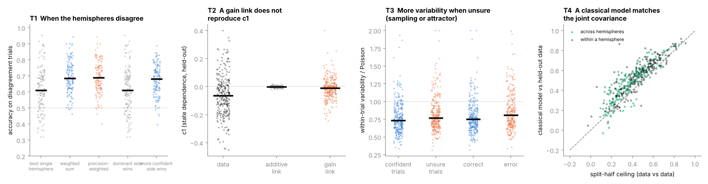
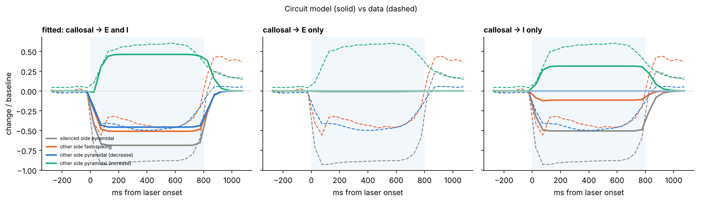

# 大胆な仮説を立て、アルゴリズムにして、一つずつ確かめる

> 01（マウスの脳梁）の解析で分かったことの外側まで、思い切った仮説を広げる。
> ルールは一つだけで、**どの仮説にも「こうなったら間違い」と言える予測を付け、確かめられるものはこのデータで確かめる**。
> 確かめられないものは、何があれば確かめられるかを書く。判定は次の4段階で付ける。
>
> | 判定 | 意味 |
> | --- | --- |
> | 支持 | 予測が当たり、対立する説明より良かった |
> | 部分的 | 当たった部分と外れた部分がある、または別の説明でも同じ予測が出る |
> | 棄却 | 予測が外れた |
> | 未検証 | このデータでは確かめられない。必要な実験を書いた |
>
> コードは `hypotheses/`、結果は `results/hypotheses/`。

---

## 0. 一枚でいうと

| # | 仮説 | 判定 | 決め手 |
| --- | --- | --- | --- |
| Q1 | 睡眠中、人の意識は共通の「量子の海」にあり、集合的無意識はそこから生じる | 未検証（現状の証拠は弱い） | 夢のテレパシー研究のメタ分析は効果が小さく、年とともに縮む。脳どうしの同期は共通の入力で説明できる。決着をつける実験の設計を書いた |
| Q2 | 脳は量子ニューラルネットワークである | 未検証（細胞内では未決着、スパイクの水準では不要） | 量子のゆらぎが計算に効くかは物理学で論争中。ただし記録できるスパイクの水準では、古典的なモデルで両半球の同時統計を再現できた（T4） |
| Q3 | 脳は確率的なアルゴリズムを実行している | 部分的 | 迷っている試行ほど神経のゆらぎが大きい（T3）。ただしアトラクターでも同じ予測が出る |
| Q4 | だから今のコンピュータでは脳を解析もシミュレーションもできない | 棄却（ここで測れた範囲では） | 確率的なアルゴリズムは普通のコンピュータで実行できる。古典的なモデルが、介入への反応（$R^2$ 0.44）と同時統計を再現した |
| B1 | 二つの半球は「委員会」で、決定は下流で両者の確信度の和として読み出される | **支持** | 意見が割れた試行で、確信度の高い側が68%で勝つ（どちらか決まった側が勝つのは61%） |
| B2 | 脳梁は抑制性細胞を通して、相手の選択の表現の利得を変える | 棄却（単純な形では） | 利得の項を入れても状態依存性は再現できない |
| B3 | 神経のゆらぎは、選択についての事後分布からのサンプルである | 部分的 | Q3と同じ |
| B4 | 古典的な潜在変数モデルで、両半球の同時統計は再現できる | **支持** | 予測の精度が、データ自身の再現性の上限に届いた |
| B5 | 脳梁の入力は興奮性と抑制性の両方の細胞に届き、その釣り合いで相手の反応が決まる | 部分的 | 平均の時間経過は再現できたが、上がる細胞・下がる細胞の割合と光の後の反動は再現できない |
| B6 | 光の後の反動は、回復の燃料になる | 棄却 | 反動の大きさと回復は無関係 |
| B7 | 主導する半球は、行動の左右の偏りで決まる | 棄却 | 無関係。ただし主導する側を止めたほうが行動は悪くなる（妥当性の確認） |

---

## 1. Aihr の仮説：「睡眠中の共通の量子の海」と「量子の脳」

元の仮説を、確かめ方の違う四つの主張に分けた。

> 集団無意識の現象から、人間は睡眠中、意識が共通の量子の海にいる（Q1）。脳のしくみは量子ニューラルネットワークで（Q2）、確率的なアルゴリズムを実行している（Q3）。だから現代のコンピュータでは脳を解析もシミュレーションもできない。そのためのハードもソフトもないから（Q4）。

### 1.1 Q2 脳は量子ニューラルネットワークか

**物理学での現状**：鍵は**デコヒーレンス**、つまり量子の重ね合わせが周りの環境とぶつかって壊れるまでの時間だ。

- Tegmark（2000）は、ニューロンの発火や微小管の状態について、重ね合わせは $10^{-13}$〜$10^{-20}$ 秒で壊れると見積もった。神経の計算の時間（ミリ秒、$10^{-3}$ 秒）より10桁以上短い。
- Hagan, Hameroff, Tuszynski（2002）はこれに反論し、条件しだいで $10^{-5}$〜$10^{-4}$ 秒まで延びうるとした（Penrose と Hameroff の Orch-OR 理論の立場）。
- Fisher（2015）は、リン原子の核スピンが脳内の分子（ポズナー分子）の中で長く量子状態を保ちうる、という別の経路を提案した。
- 最近の実験は「関係がありそうだ」という間接的なものにとどまる。微小管を安定させる薬で、ラットが麻酔で意識を失うまでの時間が延びた（Khan ら 2024）。トリプトファンの大きなネットワークで量子的な集団発光（超放射）が起きる（Babcock ら 2024）。MRIで脳の量子もつれを示したという報告（Kerskens & López Pérez 2022）には強い異論がある。

つまり、**細胞の中で量子効果が何かの役割を持つかは未決着**で、否定も肯定もされていない。

**このデータから言えること**：ここで記録したのは、数十〜数百個のニューロンのスパイクだ。

- 記録は対象を乱さない。同じ試行の中で、すべての時刻・すべてのニューロンを同時に読める。つまり、測った量すべての**同時の確率分布**がそのまま存在する。量子性の目印になるレゲット・ガーグ不等式やベル不等式の破れは、「同時の分布が存在しない」ことから生まれる。同時の分布が存在すれば、これらの不等式は数学的に必ず満たされる。
  よって、**スパイクの水準では、量子性はこのデータからは原理的に見えない**。量子効果があるとしても、細胞の中で働き、外からは「ゆらぎの源」としてしか見えない。
- そして、外から見える統計は古典的なモデルで再現できた（T4、4節）。

**判定：未検証**。細胞内の量子効果の有無は、このデータでは決められない。ただし、スパイクの水準の計算を説明するのに量子を持ち出す必要は、今のところない。

### 1.2 Q3 脳は確率的なアルゴリズムを実行しているか

これは神経科学でも有力な考え方で、「サンプリング仮説」と呼ばれる（Orbán ら 2016、Haefner ら 2016）。脳は答えを一つに決めず、「ありうる答え」を次々に試す（サンプリングする）ことで、確からしさの分布を表している、という考え方だ。

**予測**：迷っているとき（事後分布が広いとき）ほど、神経のゆらぎは大きいはずだ。

**検証（T3）**：遅延期の最後の1秒、100ミリ秒ごとの選択軸の値が、同じ試行の中でどれだけ揺れるかを測った。スパイクがポアソン的に（でたらめに）出るだけで生じる揺れで割り、ゆらぎの「余分」を求めた。

| 試行 | ゆらぎ / ポアソンの期待値（中央値、266組の半球） |
| --- | --- |
| 確信が強い試行 | 0.73 |
| 迷っている試行 | 0.77（p = 6×10⁻⁸） |
| 正答 | 0.75 |
| 誤答 | 0.81（p = 2×10⁻¹⁰） |

**予測どおり**だった。ただし、Inagaki ら（2019）のアトラクターの考え方でも同じことが予測される。谷の底（確信が強い）では揺れが小さく、谷と谷の境目（迷い）では地形が平らなので揺れが大きい。二つを区別するには、刺激の不確かさを実験者が操作する課題が要る。

**判定：部分的**。そして重要な点として、**確率的なアルゴリズムは普通のコンピュータで動く**。乱数を使うアルゴリズム（マルコフ連鎖モンテカルロ法など）は、統計や機械学習で毎日使われている。Q3 が正しくても Q4 は導かれない。

### 1.3 Q4 今のコンピュータでは脳を解析もシミュレーションもできないか

**計算理論から**：量子コンピュータが古典コンピュータより速いのは、素因数分解のような特定の問題だけである。「確率的に解ける問題」の集まり（BPP）は、古典コンピュータで乱数を使って解ける。脳が確率的なアルゴリズムを使っていても、それは古典的にシミュレーションできる（Aaronson 2013 の入門書が分かりやすい）。

**このデータから**：

- 片側を止めたときの反対側の反応を、古典的な線形モデルが試験用の試行で予測できた（$R^2$ 0.44、01 の Phase 3）。
- 両半球の同時のゆらぎ（共分散）を、古典的な潜在変数モデル（因子分析）が試験用の試行で予測できた。精度は、データを半分に分けたときの再現性（上限）に届いた（T4）。

**他の動物で**：ハエの脳の配線図（コネクトーム）から作った古典的なモデルが、視覚系の神経活動（Lappalainen ら 2024）や、味覚から運動までの処理（Shiu ら 2024）を予測している。

**判定：ここで測れた範囲では棄却**。ただし、「ヒトの脳全体を今シミュレーションできない」は事実で、理由は計算原理ではなく**データ**にある。渡辺先生の本（第13章）にあるとおり、ヒトの脳の配線は約 $10^{15}$ 本あり、生きた脳から配線の強さを読み出す手段がない。これは装置と時間の問題で、量子の問題ではない。

### 1.4 Q1 睡眠中、意識は共通の海にあるか

**証拠の現状**：

- 夢の内容で離れた場所の標的を当てる「夢のテレパシー」の実験は、1966〜2016年の40研究のメタ分析で、ランダム効果の効果量が 0.13（95%信頼区間 0.08〜0.18）だった（Storm ら 2017）。ただし、効果は年とともに小さくなり（$r=-0.29$）、研究間のばらつきが大きい。著者自身も事前登録した追試を求めている。
- 同じベッドで寝るカップルは睡眠段階がそろう（Drews ら 2020）。ただしこれは、寝返りや音のような**共通の入力**で説明できる。
- 起きている人どうしの脳の同期（ハイパースキャニング）も、同じ刺激を受けていることや、互いの言動を通したやりとりで生じる（Hasson ら 2012）。

ここで、01 のマウス研究の教訓がそのまま当てはまる。**相関していることは、通じていることの証拠にならない**。共通の入力があれば、通信がなくても相関は生まれる（01 の Phase 1〜3）。

**決着をつける実験の設計**（事前登録が前提）：

1. 二人を、音・光・振動・電磁波を遮った別々の部屋で眠らせ、脳波を記録する。
2. 時刻や体内時計の共通成分（夜の進行に伴う睡眠段階の変化）を、別の日のペアを組み替えた「偽のペア」で見積もり、差し引く。
3. 予測：仮説が正しければ、本物のペアの脳波の結合が偽のペアより強い。正しくなければ差はない。
4. 夢の内容の一致も、評価者に組み合わせを伏せて判定する。

マウスなら、01 の方法がそのまま使える。二匹を別々に眠らせて記録し、共通の入力（時刻）を除いた後に、二匹の間の相関が残るかを見ればよい。

**判定：未検証**。現状の証拠は、共通の入力という普通の説明を退けるに至っていない。

### 1.5 渡辺先生の研究との関係

先生の構想（機械半球、意識のアップロード）は、脳の意識に関わる計算が**古典的にシミュレーションできる**ことを前提にしている。Q4 が正しければ、構想そのものが成り立たない。逆に、このデータで Q4 を支持する証拠は見つからなかった。面接の雑談で話すなら、「量子説は細胞の中では未決着だが、スパイクの水準では古典モデルで足りることを自分のデータで確かめた」という形にすると、先生の前提と矛盾せず、しかも自分で考えたことが伝わる。

---

## 2. 半球の「委員会」仮説（B1）：支持

**仮説**：二つの半球は、それぞれが独立に選択の確信度 $x_A, x_B$ を持ち、行動は下流で両者を合わせて決まる。合わせ方は、統計的に最適な「確からしさで重み付けした和」になっている。

ここで $x$ は、選択軸上で境界からの距離を、ばらつきの大きさ（標準偏差）で割った値である。ガウス分布の証拠を最適に合わせると、この割った値をそのまま足し合わせることになる。だから**単純な和がすでに精度重み付きの合成**になっている。

$$
\text{決定}=\operatorname{sign}\left(\frac{\mu_A}{\sigma_A}+\frac{\mu_B}{\sigma_B}\right)=\operatorname{sign}\left(x_A+x_B\right)
$$

**アルゴリズムの比較（T1）**：遅延期の終わりの $x_A, x_B$ から、実際になめた方向を予測する。試行を二つに分け、片方で学習し、もう片方で試した（133セッション、正答・誤答の両方を含む）。

| 読み出し方 | 全試行の正答率 | 意見が割れた試行の正答率 |
| --- | --- | --- |
| よい方の半球だけ | 0.813 | 0.61 |
| 単純な和（= 確信度が大きい側に従う） | 0.829 | 0.68 |
| 重み付きの和（重みを学習） | 0.836 | 0.69 |
| 精度をさらに強調（$x|x|^g$） | 0.833 | 0.69 |

意見が割れた試行（1セッション中央値59試行）では、**確信度の高い半球が68%で勝ち**、学習用の試行で選んだ「強い方の半球」が勝つのは61%だった（どちらも p < 10⁻¹³）。
精度をさらに強調する項（$g>0$）は、ほとんどのセッションで選ばれなかった（266回中175回が $g=0$）。

**読み方**：01 で H4（精度ゲート）は脳梁のリンクとしては支持されなかった。しかし同じ考え方は、**下流の読み出し**で成り立っている。最適な合成はリンクではなく、二つの半球の出力が合流する先（皮質下の運動系など）で起きていると考えられる。
これは、分離脳の患者で「知覚は分かれるが、応答は一つ」だったこと（Pinto ら 2017）とも合う。統一は脳梁ではなく、出力の合流点で作られるのかもしれない。01 の Phase 1 で、誤答のときにも左右がそろいやすかったこと（61% 対 期待値 53%）も、共通の読み出しを支える。

---

## 3. 利得の仮説（B2）：単純な形では棄却

**仮説**：脳梁の入力は反対側の抑制性細胞を駆動する（01 の Phase 5）。だから相手を止めると、こちらの選択の表現の**利得（倍率）**が変わる。これが、確信度の高い試行ほど大きく落ちる状態依存性（$c_1<0$）の原因である。

**アルゴリズム（T2）**：選択軸の動きに、Aの集団の平均発火率 $u(t)$ との積の項を入れた。

$$
x_B(t+1)=x_B+a(t)+k\,x_B+p\,u(t)+m\,u(t)\,x_B
$$

$m\ne 0$ なら利得の効果がある。$m=0$ の加算型と比べた。

| | $c_1$（中央値） |
| --- | --- |
| 実データ | −0.065 |
| 加算型 | 0.000 |
| 利得型 | −0.010 |

利得型は加算型よりわずかに実データに近い（差 0.003、p = 0.03）。$m$ も正にやや偏る（59%、p = 6×10⁻⁴）。しかし、実データの $c_1$ の6分の1しか出ない。

**判定：単純な形では棄却**。Aの「平均の」発火率を利得の担い手にしたのが粗すぎた可能性がある。次は、FS細胞の発火率そのものを利得の項に入れる。

---

## 4. 古典的なモデルで十分か（B4、Q4の検証）：支持

**アルゴリズム（T4）**：両半球のニューロンをまとめて、遅延期の最後400ミリ秒のスパイク数に因子分析をかけた（数個の隠れた要因が、すべてのニューロンのゆらぎを生むとする古典的なモデル）。訓練用の半分の試行で学習し、残りの試行の共分散をどれだけ予測できるかを測った。比べる上限は「試験用の試行を二つに分けたときの、片方からもう片方への予測」である。

| | モデル vs 試験データ | 上限（データ vs データ） |
| --- | --- | --- |
| 同じ半球の中のニューロンの組 | 0.56 | 0.46 |
| **左右の半球にまたがる組** | **0.51** | 0.39 |

モデルは上限を上回った（訓練データが多いのと、モデルが雑音をならすため）。訓練データそのものの共分散（0.48）よりもよい。
**数個の古典的な隠れ要因で、左右の半球にまたがる同時のゆらぎまで説明できる**。量子的なしくみを持ち出す余地は、少なくともこの水準の統計にはない。

---

## 5. 回路の仮説（B5）：部分的

**仮説**：脳梁の入力は、反対側の錐体細胞と抑制性細胞の両方に届く。片側を止めると、錐体細胞への直接の興奮が消える一方で、抑制性細胞を介した抑制も消える。その釣り合いで、反対側の細胞は下がったり上がったりする。

**アルゴリズム（T5）**：各半球に、興奮性400個・抑制性80個の発火率モデルを置いた。発火率は閾値以上で入力に比例する（閾値線形）。結合はまばらでランダムで、ニューロンごとに強さがばらつく。両半球の興奮性細胞が、相手の興奮性細胞（強さ $c_E$）と抑制性細胞（強さ $c_I$）に投射する。
光による抑制は実験と同じく、抑制性細胞に0.8秒の追加入力を入れ、最後の0.2秒で弱めて表した。

四つの数（$c_E, c_I$、光の強さ、局所の抑制の強さ）を、01 の Phase 5 で測った四つの平均の時間経過に合わせて探した（160通り）。
そのうえで、**合わせるのに使っていない三つの量**で試した。

| 量 | データ | モデル |
| --- | --- | --- |
| 平均の時間経過（合わせた量） | — | おおむね再現 |
| 反対側で2割以上下がる錐体細胞の割合 | 42% | 90% |
| 反対側で2割以上上がる錐体細胞の割合 | 20% | 1% |
| 光の後の反対側FSの反動 | +40% | 0% |

比較のために、投射先を片方に絞ったモデルも作った。

- 興奮性細胞だけに投射するモデルは、まったく合わない。
- 抑制性細胞だけに投射するモデルは、上がる細胞は作れるが、下がる細胞を作れない。

**判定：部分的**。両方への投射が要ることは支持された。しかし、このモデルでは細胞の多くが同じ向きに動いてしまう。実データのように上がる細胞と下がる細胞が混ざるには、細胞ごとの「脳梁の興奮と抑制の比」のばらつきが、もっと大きくなければならない。
光の後の反動は、止めた側の細胞の**順応**（発火を続けると疲れ、止めた後に戻りすぎる性質）を入れないと出ない。次はこの二つを入れる。

---

## 6. 小さく確かめた仮説

| 仮説 | 予測 | 結果 | 判定 |
| --- | --- | --- | --- |
| B6 光の後の反動は、回復の燃料になる | 光の後の反応が大きい組ほど、選択の情報がよく回復する | 順位相関 −0.07（p = 0.27） | 棄却 |
| B7 主導する半球は、行動の左右の偏り（右なめと左なめの正答率の差）で決まる | 偏りとモジュール性の左右差が相関する | 順位相関 −0.15（p = 0.11） | 棄却 |
| （B7 の確認）主導する側を止めたほうが、行動は悪くなる | 主導の向きと、止めたときの成績低下の左右差が相関する | 順位相関 0.35（p = 1×10⁻⁴） | 支持（モジュール性の指標が行動の意味を持つことの確認） |

---

## 7. まだ確かめていない大胆な仮説（設計だけ）

| 仮説 | 予測 | 必要なデータ・実験 |
| --- | --- | --- |
| 脳梁は「状態」ではなく「予測誤差」を運ぶ（予測符号化） | 受け手の反応は、送り手の活動が予想から外れる瞬間（刺激の出始め、選択の切り替わり）に大きい | 遅延期の中の、いろいろな時刻に短く止める実験（Javadzadeh & Hofer 2022 型） |
| 睡眠中、左右の半球は切り離される | 睡眠中は脳梁を介した結合が弱まり、左右の相関の多くが共通入力（視床）由来になる | 睡眠中の両側同時記録と、短い片側抑制 |
| 統一は出力の合流点で作られる（B1 の延長） | 合流点（上丘や延髄の運動核）を止めると、左右の半球は保たれたまま、行動だけが「分離脳」になる | 合流点の候補の抑制と、両側ALMの同時記録 |
| 機械半球（渡辺先生）の最小条件は「読み出しの合流」と「抑制性細胞への書き込み」 | 分離脳ワールドモデルで、リンクなしでも共有の読み出しがあれば行動は統一され、リンクが抑制を通すと選択の頑健さが上がる | 分離脳ワールドモデル（別リポジトリ）で実装 |
| 意識の統一には「同時の分布が作れる」ことが要る（Q2 の裏返し） | 統合された系では、各部分の状態の同時の分布が、どの部分の観測からも同じに推定できる | 理論の整理。実験より先に定式化 |

---

## 8. 次にやること

1. B2 の改良：FS細胞の発火率を利得の担い手にして、状態依存性を再現できるかを見る。
2. B5 の改良：細胞ごとの興奮と抑制の比のばらつきと、順応を入れた回路モデルで、上がる細胞・下がる細胞の割合と反動を予測する。
3. B1 を分離脳ワールドモデルに移す：二つのモデルの間にリンクを置かず、共有の読み出しだけを置いた条件を加える（split-brain-world-models の計画書を改訂）。

---

## 参考文献

- Tegmark M. Importance of quantum decoherence in brain processes. *Phys Rev E* **61**(4), 4194–4206 (2000). https://doi.org/10.1103/PhysRevE.61.4194
- Hagan S, Hameroff SR, Tuszynski JA. Quantum computation in brain microtubules: decoherence and biological feasibility. *Phys Rev E* **65**(6), 061901 (2002). https://doi.org/10.1103/PhysRevE.65.061901
- Hameroff S, Penrose R. Consciousness in the universe: a review of the 'Orch OR' theory. *Phys Life Rev* **11**(1), 39–78 (2014). https://doi.org/10.1016/j.plrev.2013.08.002
- Fisher MPA. Quantum cognition: the possibility of processing with nuclear spins in the brain. *Ann Phys* **362**, 593–602 (2015). https://doi.org/10.1016/j.aop.2015.08.020
- Kerskens CM, López Pérez D. Experimental indications of non-classical brain functions. *J Phys Commun* **6**, 105001 (2022). https://doi.org/10.1088/2399-6528/ac94be
- Khan S ほか. Microtubule-stabilizer epothilone B delays anesthetic-induced unconsciousness in rats. *eNeuro* **11**, ENEURO.0291-24.2024 (2024). https://doi.org/10.1523/ENEURO.0291-24.2024
- Babcock NS ほか. Ultraviolet superradiance from mega-networks of tryptophan in biological architectures. *J Phys Chem B* **128**, 4035–4046 (2024). https://doi.org/10.1021/acs.jpcb.3c07936
- Orbán G, Berkes P, Fiser J, Lengyel M. Neural variability and sampling-based probabilistic representations in the visual cortex. *Neuron* **92**(2), 530–543 (2016). https://doi.org/10.1016/j.neuron.2016.09.038
- Haefner RM, Berkes P, Fiser J. Perceptual decision-making as probabilistic inference by neural sampling. *Neuron* **90**(3), 649–660 (2016). https://doi.org/10.1016/j.neuron.2016.03.020
- Busemeyer JR, Bruza PD. *Quantum Models of Cognition and Decision*. Cambridge University Press (2012). https://doi.org/10.1017/CBO9780511997716
- Aaronson S. *Quantum Computing since Democritus*. Cambridge University Press (2013). https://doi.org/10.1017/CBO9780511979309
- Lappalainen JK ほか. Connectome-constrained networks predict neural activity across the fly visual system. *Nature* **634**, 1132–1140 (2024). https://doi.org/10.1038/s41586-024-07939-3
- Shiu PK ほか. A Drosophila computational brain model reveals sensorimotor processing. *Nature* **634**, 210–219 (2024). https://doi.org/10.1038/s41586-024-07763-9
- Storm L, Sherwood SJ, Roe CA, Tressoldi PE, Rock AJ, Di Risio L. On the correspondence between dream content and target material under laboratory conditions: a meta-analysis of dream-ESP studies, 1966–2016. *Int J Dream Res* **10**(2), 120–140 (2017). http://hdl.handle.net/2440/109699
- Drews HJ ほか. Bed-sharing in couples is associated with increased and stabilized REM sleep and sleep-stage synchronization. *Front Psychiatry* **11**, 583 (2020). https://doi.org/10.3389/fpsyt.2020.00583
- Hasson U ほか. Brain-to-brain coupling: a mechanism for creating and sharing a social world. *Trends Cogn Sci* **16**(2), 114–121 (2012). https://doi.org/10.1016/j.tics.2011.12.007
- Inagaki HK, Fontolan L, Romani S, Svoboda K. Discrete attractor dynamics underlies persistent activity in the frontal cortex. *Nature* **566**, 212–217 (2019). https://doi.org/10.1038/s41586-019-0919-7
- Pinto Y ほか. Split brain: divided perception but undivided consciousness. *Brain* **140**(5), 1231–1237 (2017). https://doi.org/10.1093/brain/aww358
- Javadzadeh M, Hofer SB. Dynamic causal communication channels between neocortical areas. *Neuron* **110**(15), 2470–2483.e7 (2022). https://doi.org/10.1016/j.neuron.2022.05.011
- 渡辺正峰『意識の脳科学 「デジタル不老不死」の扉を開く』講談社現代新書, 講談社, 2024. ISBN 978-4-06-536111-5
