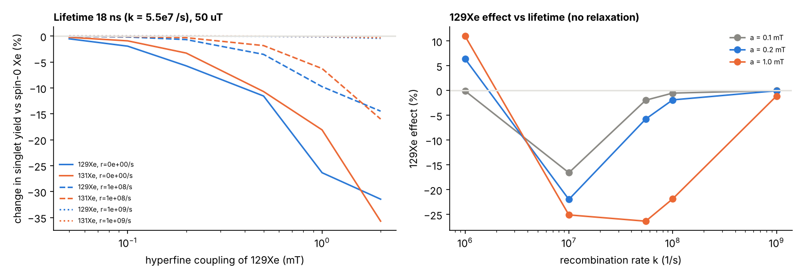
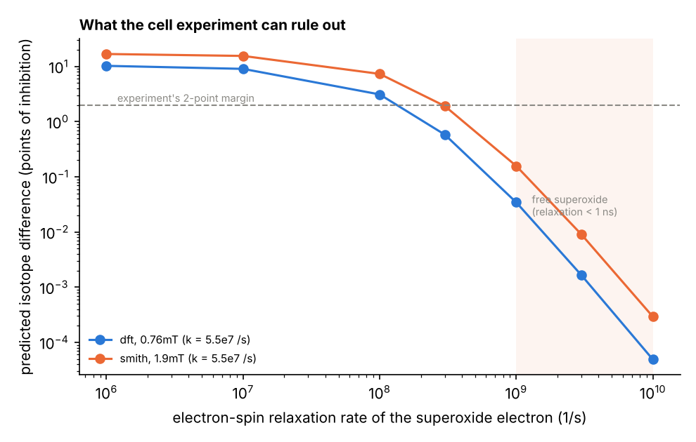

# 03 量子脳を細胞の水準で確かめる ― 仮説の分解から、決着のつく実験まで

> **この文書の位置づけ**：01（マウスの脳梁）、02（分離脳ワールドモデル）に続く三つ目のプロジェクト。
> Aihr の仮説「脳は量子ニューラルネットワークで、だから今のコンピュータでは脳を解析もシミュレーションもできない」を、
> 確かめ方の違う主張に分け、手元のデータで確かめられる部分は確かめた。そのうえで、残った「細胞の中の量子効果」を
> 決着させる実験（5節）と、その実験の価値を決める計算（6・7節）を設計する。見直しの経緯は [00_review_log.md](00_review_log.md) にある。
>
> **本題の置き方（2026-10-29）**：実験には設備と共同研究者が要るので、入学前から一人で進められる**計算の側**を本題に据えた（7節）。
> 「どの組み合わせなら測れる大きさの効果が出るか」の地図を作ることが、実験をする研究室にとっても使える成果になる。

---

## 0. 一枚でいうと

| 主張 | 判定 | 決め手 |
| --- | --- | --- |
| Q1 睡眠中、人の意識は共通の「量子の海」にある | 未検証（今の証拠は弱い） | 夢のテレパシー研究のメタ分析は効果が小さく、年とともに縮む。脳どうしの同期は共通の入力で説明できる |
| Q2 脳は量子ニューラルネットワークである | **細胞の中は未決着、スパイクの水準では不要** | スパイクの記録からは量子性は原理的に見えない。見える統計は古典的なモデルで再現できた |
| （細胞の中で）核スピンが効く道は何通りあるか | **ラジカル対の一本に絞れた** | 体温では平衡の効果は $kT$ の $10^{-10}$ 倍、重さの効果はキセノンで1%以下（6節） |
| Q3 脳は確率的なアルゴリズムを実行している | 部分的 | 迷う試行ほど神経のゆらぎが大きい。ただしアトラクターでも同じ予測が出る |
| Q4 だから今のコンピュータでは脳を解析もシミュレーションもできない | 測れた範囲では棄却 | 確率的なアルゴリズムは古典計算機で動く。古典モデルが、介入への反応も同時の統計も再現した |

残る問いは一つになる。**細胞の中の化学で、量子効果（スピン）が神経の働きに効いているか**。
これを確かめる最も強い方法は、化学的にはほぼ同じで**核スピンだけが違う同位体**を入れ替えることだ。

本文の結論：

1. 有名な行動の報告（Li ら 2018、キセノン同位体の麻酔の効きの差）は、原典を読むと**同位体ごとに実験が1回しかなく**、下地の麻酔薬のわずかな狂いで説明できてしまう。
2. そこで、行動ではなく**培養ニューロンの NMDA 受容体の電流**（Franks ら 1998 の方法）で、同じ細胞の上で同位体を入れ替えて比べる。報告どおりの差なら数個の細胞で、報告の5分の1の差でも約100個の細胞で決着がつく。
3. それとは別に、海馬の切片でリチウム同位体が正反対の大きな効果を持つという2025年の報告を、盲検・事前登録で追試する。
4. 計算で、スピンが効きうる道をラジカル対の一本に絞り、さらにその成否を二つの条件に絞った。体温では核スピンのエネルギーは熱エネルギーの $10^{-10}$ 倍しかないので、平衡では効果が出ない。重さの古典的な効果も、キセノンでは1%以下である。残るラジカル対の道が成り立つには、**キセノンがスーパーオキシドの不対電子の軌道の真上に向きを固定されて座り**（自由に回ると実効的な結合は 0.36 mT に落ちる）、かつ**電子スピンの緩和が $10^{8}$/s より遅い**必要がある。どちらも自明ではなく、特に二番目は遊離のスーパーオキシドの値（$10^{9}$/s 以上）と2桁食い違う。実験で見るべき差の大きさを、この二つの関数として表にして登録した（6節）。

---

## 1. 前提知識

### 1.1 量子の「重ね合わせ」と「デコヒーレンス」

量子の世界では、粒子は「上向きでも下向きでもある」ような重ね合わせの状態をとれる。量子コンピュータは、この重ね合わせを計算に使う。
ただし、重ね合わせは周りの分子とぶつかるたびに壊れる。これを**デコヒーレンス**と呼ぶ。温かく湿った脳の中では、壊れるまでの時間が極めて短いと考えられている。

| 見積もり | 対象 | 重ね合わせが壊れるまでの時間 |
| --- | --- | --- |
| Tegmark 2000 | ニューロンの発火、微小管の状態 | $10^{-20}$〜$10^{-13}$ 秒 |
| Hagan, Hameroff, Tuszynski 2002（Orch-OR の立場からの反論） | 微小管（遮蔽を仮定） | $10^{-5}$〜$10^{-4}$ 秒 |
| Fisher 2015 | リン原子の核スピン（ポズナー分子の中） | 数秒以上の可能性 |

神経の計算はミリ秒（$10^{-3}$ 秒）の単位で進む。電子の状態の重ね合わせはそれより何桁も早く壊れるが、**原子核のスピン**は周りとの相互作用が弱いので、ずっと長く保たれうる。量子効果を探すなら、核スピンが本命になる。

### 1.2 核スピンと同位体

同じ元素でも、原子核の中の中性子の数が違うものを**同位体**と呼ぶ。化学的な性質（電子の配置）はほぼ同じだが、**重さ**と**核スピン**が違う。

| 同位体 | 核スピン $I$ | 同位体 | 核スピン $I$ |
| --- | --- | --- | --- |
| ¹²⁹Xe | 1/2 | ⁶Li | 1 |
| ¹³¹Xe | 3/2 | ⁷Li | 3/2 |
| ¹³²Xe・¹³⁴Xe・¹³⁶Xe | 0 | | |

古典的な化学では、同位体の違いは主に重さとして効く（重いほど振動や拡散が少し遅い）。重さで説明できず、**スピンの有無に沿って**効き目が変わるなら、スピンに依存する過程（量子力学なしには説明できない過程）が関わっている強い証拠になる。

### 1.3 スピンが化学に効くしくみの候補

| しくみ | 中身 | 予測される指紋 |
| --- | --- | --- |
| ラジカル対機構 | 電子のスピンが対になった短命の分子（ラジカル対）が、一重項と三重項の間を行き来する速さが、近くの核スピンと外部磁場で変わる。渡り鳥の磁気感覚の有力な説 | 核スピンを持つ同位体で効果が変わる。弱い静磁場で変わる。特定の周波数のラジオ波で乱れる |
| ポズナー分子の核スピン（Fisher 2015） | リン酸カルシウムの塊の中で、³¹P の核スピンがもつれを長く保つ | ⁶Li と ⁷Li で効果が違う |

---

## 2. 仮説の分解と、手元のデータでの検証

Aihr の元の仮説はこうだった。

> 集団無意識の現象から、人間は睡眠中、意識が共通の量子の海にいる（Q1）。脳のしくみは量子ニューラルネットワークで（Q2）、確率的なアルゴリズムを実行している（Q3）。だから現代のコンピュータでは脳を解析もシミュレーションもできない（Q4）。

### 2.1 Q2：スピンの水準では量子性は原理的に見えない

01 で記録したのは、数十〜数百個のニューロンのスパイクだ。この記録は対象を乱さず、同じ試行の中で、すべての時刻・すべてのニューロンを同時に読める。つまり、測った量すべての**同時の確率分布**がそのまま存在する。

量子性の目印であるベル不等式やレゲット・ガーグ不等式の破れは、「すべての量に同時の分布を与えることができない」ことから生まれる。逆に、同時の分布が存在すれば、これらの不等式は数学的に必ず満たされる（Fine の定理）。
したがって、**スパイクの記録からは、量子性は原理的に検出できない**。量子効果があるとしても、それは細胞の中で働き、外からは「ゆらぎの源」としてしか見えない。

実際、外から見える統計は古典的なモデルで再現できた。

| 検証 | 結果 |
| --- | --- |
| 両半球のニューロンのゆらぎ（共分散）を、数個の隠れ要因の古典モデル（因子分析）で予測 | 左右にまたがる組でも、データを半分に分けたときの再現性（上限）に届いた（予測 0.51 対 上限 0.39） |
| 同じことを、遅れと向きまで推定する動的な古典モデル（DLAG、01 の Phase 6）で | 左右にまたがる、向きのある成分を126セッションの88%で見つけた |
| 片側を止めたときの反対側の反応を、古典的な線形モデルで予測 | 試験用の試行で $R^2$ 0.44（01 の Phase 3） |

### 2.2 Q3：確率的なアルゴリズム

「脳は答えを一つに決めず、ありうる答えを次々に試すことで、確からしさの分布を表している」という考え方を**サンプリング仮説**と呼ぶ（Orbán ら 2016）。迷っているほど神経のゆらぎは大きいはずだ。
遅延期の最後の1秒、100ミリ秒ごとの選択軸の値が同じ試行の中でどれだけ揺れるかを、スパイクがでたらめに出るだけで生じる揺れ（ポアソンの期待値）で割って測った。

| 試行 | ゆらぎ ÷ ポアソンの期待値（中央値、266の半球） |
| --- | --- |
| 確信が強い ／ 迷っている | 0.73 ／ 0.77（p = 6×10⁻⁸） |
| 正答 ／ 誤答 | 0.75 ／ 0.81（p = 2×10⁻¹⁰） |

予測どおりだが、アトラクター（谷の底では揺れが小さく、谷の境目では大きい）でも同じ予測が出るので、**部分的**とした。
そして要点として、確率的なアルゴリズムは普通のコンピュータで動く。乱数を使って解ける問題の集まり（計算量理論の BPP）は古典計算機の守備範囲で、Q3 が正しくても Q4 は導かれない。

### 2.3 Q4：シミュレーションできないか

量子コンピュータが古典より速いと分かっているのは、素因数分解のような特定の問題だけだ。2.1 のとおり、測れた範囲の脳の統計は古典モデルで再現できた。ハエでは、配線図から作った古典モデルが視覚系の活動や（Lappalainen ら 2024）、味覚から運動までの処理を予測している（Shiu ら 2024）。

**判定：測れた範囲では棄却**。ヒトの脳を今シミュレーションできないのは事実だが、理由は計算の原理ではなく**データ**にある。約 $10^{15}$ 本のシナプスの強さを生きた脳から読み出す手段がない（渡辺『意識の脳科学』第13章）。
01 の結論もこれと同じ向きだ。脳梁の通信は普通の活動の相関からは推定できず、介入のデータを要した。足りないのは量子の計算資源ではなく、**介入のデータ**である。

### 2.4 Q1：睡眠中の共通の海

| 証拠 | 中身 | 普通の説明 |
| --- | --- | --- |
| 夢のテレパシーのメタ分析（Storm ら 2017、1966〜2016年の40研究） | 効果量 0.13（95%区間 0.08〜0.18）。ただし年とともに小さくなる（$r=-0.29$） | 小さな効果を追う研究で典型的な、出版の偏りと方法の改善 |
| 同じベッドのカップルの睡眠段階がそろう（Drews ら 2020） | — | 寝返りや音などの共通の入力 |
| 起きている人どうしの脳の同期（Hasson ら 2012） | — | 同じ刺激と、互いの言動を通したやりとり |

01 の教訓がそのまま当てはまる。**相関していることは、通じていることの証拠にならない**。
決着をつけるには、二人を音・光・振動・電磁波を遮った別々の部屋で眠らせて脳波を記録すればよい。夜の進行に伴う共通の変化は、別の日のペアを組み替えた「偽のペア」で見積もって差し引く。本物のペアの結合が偽のペアより強いかを、事前登録して調べる。

**判定：未検証**。今の証拠は、共通の入力という普通の説明を退けるに至っていない。

---

## 3. 何を示せば「証明」になるか

「量子脳」という言葉には、強さの違う主張が混ざっている。混ぜると議論が崩れるので分けておく。

| 段階 | 主張 | 示し方 | 現状 |
| --- | --- | --- | --- |
| S1 | 神経の働きに、スピンに依存する化学が関わる | 核スピン同位体・弱い磁場の効果 | 行動の水準で報告あり（Xe、Li）。細胞の水準は未確立 |
| S2 | その過程が、神経の情報処理（発火の統計）を変える | S1 の操作で、発火の統計が古典的な雑音モデルで説明できない形で変わる | 未検証 |
| S3 | 脳は重ね合わせやもつれを計算に使っている | 多体のコヒーレンスが計算上の利得を生むことを示す | 証拠なし。デコヒーレンスの見積もりと強く衝突 |
| S4 | だから脳は今のコンピュータで原理的にシミュレーションできない | S3 に加え、その計算が古典的に効率よく再現できないこと | 証拠なし |

細胞の水準で現実に狙えるのは **S1 と S2** だ。S1 が示されても、Aihr の元の仮説の後半（S3・S4）が示されたことにはならない。逆に S1 が否定されれば、「量子効果が神経に効いている」という主張の有力な足場が一つ消える。**どちらの結果でも論文になる**ように設計する。

---

## 4. 原典の精読：何が分かっていて、どこが弱いか

### 4.1 Li ら 2018：キセノン同位体の麻酔の効き（*Anesthesiology* 129:271–277）

**報告**：マウス80匹（各同位体20匹）で、正向反射が消える（ひっくり返されても起き上がれなくなる）キセノン濃度の中央値（ED50）を測った。

| 同位体 | 核スピン | イソフルラン 0.50% との併用での ED50 | キセノンだけに換算した ED50 |
| --- | --- | --- | --- |
| ¹³²Xe | 0 | 15 ± 4% | 70〜71% |
| ¹³⁴Xe | 0 | 16 ± 5% | 72% |
| ¹³¹Xe | 3/2 | 22 ± 5% | 99% |
| ¹²⁹Xe | 1/2 | 23 ± 7% | 105% |

核スピンを持つ二つは効きが弱く（多く要る）、スピンを持たない二つは同じだった。四つの分極率は量子化学計算で同じ（3.60 ų）。著者は「重さでも電子殻でも説明できず、核スピンが残る」と結論した。

**精読して見つけた弱点**：

1. **同位体ごとの実験は実質1回**。20匹を一つの箱（6 L）に入れ、濃度を2.5%ずつ上げながら同時に測っている。統計は20匹を独立に数えているが、日・箱の状態・ガスのボトルなどの条件は、同位体ごとに一つずつしかない。
2. **キセノンだけの値は外挿**。マウスはキセノンだけで眠らせると酸素が足りなくなる。そこでイソフルラン0.50%（それだけで眠る濃度0.64%の78%）を下地に入れ、残り22%をキセノンで埋めた量を測った。キセノンだけの値は、測った値を0.22で割って求めており、差は約4.5倍に拡大されている。
3. **下地の麻酔薬の狂いに極めて敏感**。必要なキセノンの量は

$$
\text{Xe}_{\rm needed}=\mathrm{ED50}_{\rm Xe}\Big(1-\frac{\text{iso}}{0.64}\Big)
\quad\Rightarrow\quad
\frac{\partial\,\text{Xe}_{\rm needed}}{\partial\,\text{iso}}=-\frac{\mathrm{ED50}_{\rm Xe}}{0.64}\approx-110
$$

イソフルランが0.01%（絶対値）ずれると、必要なキセノンは約1.1ポイント変わる。報告された差（約7ポイント）は、同位体ごとの測定日でイソフルランが約0.06%ずれれば説明できる。論文はイソフルランを「0.50 ± 0.01%」に保ったと書くが、これはガスモニターの読みのばらつきで、日ごとの絶対的な校正のずれは含まない。

4. 良い点もある。判定者は盲検で、溶けたガスの濃度はガスクロマトグラフィーで確かめている。

**結論**：報告は興味深いが、同位体と測定日が完全に重なっているため、**スピンの効果と日ごとのずれを区別できない**。独立の追試は、調べた範囲では見つからなかった。

### 4.2 Franks ら 1998：キセノンは NMDA 受容体を抑える（*Nature* 396:324）

培養したラット海馬のニューロンで次のことを示した。この測定が、細胞の水準の実験の土台になる。

| 測定 | 結果 |
| --- | --- |
| NMDA で流れる電流（膜電位 −60 mV に固定） | キセノン80%で約60%減る。NMDA の EC50（24 ± 2 µM）とヒル係数（1.2）は変わらない（競合しない阻害） |
| 自分自身にシナプスを作るニューロン（オータプス）の興奮性シナプス電流 | 遅い NMDA 成分は70%以上減る。速い非 NMDA 成分はほとんど変わらない |
| GABA_A 受容体（3 mM GABA） | キセノン100%でもほぼ変わらない。抑制性シナプス電流は 8 ± 2% 減るだけ |

### 4.3 リチウム同位体：海馬切片での大きな逆向きの効果（2025年のプレプリント）

ウォータールー大学のグループ（Leonenko、Gingras ら）は、ラット海馬 CA1 の切片を多電極アレイで記録し、20 mM の塩化リチウムを20分流したときの興奮性シナプス電位を報告した。

| 同位体 | 電位の大きさ | 2発刺激の促通 | 長期増強の誘導期 |
| --- | --- | --- | --- |
| ⁶Li | 約 +32% | 130% → 169% | 約 15% |
| ⁷Li | 約 −58% | 127% → 91% | 約 60% |

GSK-3β の活性、培養細胞の生存、ミトコンドリアのカルシウム交換には差がなかった（同グループの学会発表）。
ただし、各群5匹（各2切片）で、盲検と無作為化の記載がなく、濃度は一つだけ（治療域の約20倍）である。

---

## 5. 実験の設計

### 5.1 全体の順序

| 段階 | 実験 | 目的 | 費用・期間の目安 |
| --- | --- | --- | --- |
| 1a | リチウム同位体の切片実験の盲検追試（5.3） | 巨大な効果が本物か | 安い（リチウム塩）、数か月 |
| 1b | キセノン同位体の NMDA 電流の比較（5.2） | Li 2018 の差が細胞で出るか | 濃縮キセノンは高価だが、細胞の実験は使う量が少ない |
| 2 | キセノン5同位体の「重さとスピンの階段」（5.4） | 差が重さかスピンかを切り分ける | 1b で差が出たときだけ |
| 3 | 弱い磁場とラジオ波（5.5） | ラジカル対機構かを確かめる | 2 で差が出たときだけ |

各段階の結果が否定なら、そこで止めて論文にする。肯定なら次へ進む。

### 5.2 段階1b：同じ細胞の上でキセノン同位体を入れ替える

**標本**：Franks 1998 と同じ、培養ラット海馬ニューロン（オータプス）。加えて、NMDA 受容体（GluN1/GluN2A）だけを発現させた培養細胞株（HEK293）。

二つを並べる理由はこうだ。ニューロンで差が出て細胞株で出なければ、差は受容体そのものではなく、ニューロンの中の別の過程（たとえばラジカル反応）にある。両方で出れば、受容体への結合の段階にある。

**手順**：

1. 細胞を電位固定し、NMDA（100 µM）を短く当てて電流を測る。
2. キセノン50%（と酸素20%、残り窒素）で平衡させた液に切り替え、同じ NMDA 刺激で電流を測る。抑制率を求める。
3. 洗い流してから、別の同位体で 2 を繰り返す。一つの細胞で2〜4種類の同位体を測り、**順番は細胞ごとに無作為**にする。
4. 液の中のキセノン濃度は、その場でガスクロマトグラフィーにより測る。
5. 同位体のボトルには暗号のラベルを貼り、測定と解析が終わるまで中身を伏せる。

**予測**：Franks の値（80%で60%抑える）から、キセノンの効き方をヒル係数1と仮定すると、半分抑える濃度は約53%になる。Li 2018 の比（スピンを持つ同位体は約1.45倍多く要る）がそのまま細胞で成り立つなら、キセノン50%での抑制率は

$$
I_{132}=\frac{50}{50+53}\approx 0.48,\qquad I_{129}=\frac{50}{50+53\times1.45}\approx 0.39
$$

となり、差は約9ポイントになる。

**必要な細胞の数**（同じ細胞の上での差のばらつきを標準偏差 $\sigma$、検出したい差を $\delta$、有意水準5%、検出力90%）は

$$
n=\Big(\frac{(z_{0.975}+z_{0.90})\,\sigma}{\delta}\Big)^2
$$

| 想定する差 | $\sigma$ = 4 ポイント | $\sigma$ = 6 | $\sigma$ = 8 |
| --- | --- | --- | --- |
| Li 2018 どおり（約9ポイント） | 3 | 5 | 9 |
| その半分（約4.5ポイント） | 9 | 18 | 33 |
| 5分の1（約2ポイント） | 43 | 95 | 169 |

1条件あたり**約100個の細胞**を事前登録の目標にすれば、報告の5分の1の効果まで検出できる。差が ±2 ポイントの範囲に収まれば、「細胞の水準では効果がない」と判定する（同等性の検定）。

**古典的な説明をつぶす対照**：

| 古典的な説明 | 対照 |
| --- | --- |
| 同位体の重さによる差（溶解度・拡散） | 段階2の「質量の線」で取り除く。液の中の濃度を実測し、実測濃度で比べる |
| ガスの純度の違い | ボトルごとに質量分析で濃縮度と不純物を測る（Li 2018 の濃縮度は93.5%） |
| 測る順番による変化（電流の自然な減衰） | 順番を無作為にし、同じ同位体を最初と最後に二度測る細胞を一部に入れる |
| 実験者の思い込み | 二重盲検。解析コードは、データを開ける前に公開の場所に登録する |

### 5.3 段階1a：リチウム同位体の切片実験の追試

| 項目 | 原報告 | 追試 |
| --- | --- | --- |
| 匹数 | 各群5匹（各2切片） | 各群12匹以上。切片は匹の中で平均し、匹を単位に検定 |
| 盲検・無作為化 | 記載なし | 塩の瓶に暗号のラベル。同じ動物の切片を各条件に無作為に割り付け |
| 濃度 | 20 mM のみ | 1・5・20 mM（治療域の血中濃度は約1 mM） |
| 事前登録 | なし | 主要評価（流した後の電位の大きさの、⁶Li と ⁷Li の差）と判定基準を登録 |

原報告どおりなら差は約90ポイントと巨大で、12匹ずつなら確実に検出できる。差が ±10 ポイントの同等性の範囲に収まれば、原報告は再現しないと判定する。

### 5.4 段階2：重さとスピンの階段

段階1bで差が出たら、キセノンの5つの同位体（¹²⁹Xe、¹³¹Xe、¹³²Xe、¹³⁴Xe、¹³⁶Xe）で同じ測定をする。同位体 $k$ の効き目を $E_k$、質量を $m_k$ とする。
古典的な効果だけなら、効き目は質量のなめらかな関数になる。

$$
E_k=\beta_0+\beta_1\,(m_k-\bar m)+\varepsilon_k
$$

スピンを持たない3つで質量の線を引き、スピンを持つ2つがそこからどれだけ外れるかを測る。

$$
\Delta_{\rm spin}=\frac{1}{2}\sum_{k\in\{129,131\}}\Big(E_k-\hat E^{(0)}(m_k)\Big)
$$

古典的なら $\Delta_{\rm spin}=0$ になる。ラジカル対機構なら、¹²⁹Xe の磁気回転比の大きさは ¹³¹Xe の約3.4倍なので、¹²⁹Xe のほうが大きく外れると予想できる。
Li 2018 では ¹²⁹Xe（ED50 105%）が ¹³¹Xe（99%）より有意に効きが弱く、この予想と同じ向きだった。

### 5.5 段階3：磁場とラジオ波

1. 弱い静磁場：0付近（磁気シールドの中）、地磁気程度（約50 µT）、約1 mT。ラジカル対なら、$\Delta_{\rm spin}$ の大きさが磁場で変わる。
2. ラジオ波：電子スピンの歳差運動の周波数（ラーモア周波数）に近い弱いラジオ波で、ラジカル対の効果は乱れる。地磁気の中では

$$
f_{\rm L}=\frac{g\,\mu_B\,B}{h}\approx 28\ \mathrm{GHz/T}\times 50\ \mu\mathrm{T}\approx 1.4\ \mathrm{MHz}
$$

なので、1〜数 MHz で $\Delta_{\rm spin}$ が消えるかを見る。電流は流すが磁場を打ち消す巻き方の「偽コイル」で、発熱や振動の対照をとる。

---

## 6. 計算：スピンが効きうる道を絞る（電気電子工学の強みを使う）

実験の前に、ラジカル対の理論模型で「どの同位体で、どの磁場で、どれだけの差が出るはずか」を計算する。
ラジカル対の2つの電子スピン $\hat{\mathbf S}_1,\hat{\mathbf S}_2$ と、近くの核スピン $\hat{\mathbf I}_k$ のハミルトニアン（エネルギーを表す演算子）は

$$
\hat H=g\mu_B\,\mathbf B\cdot(\hat{\mathbf S}_1+\hat{\mathbf S}_2)+\sum_{k}a_k\,\hat{\mathbf I}_k\cdot\hat{\mathbf S}_1
$$

で、第1項が外部磁場、第2項が超微細相互作用（$a_k$ は結合の強さ）だ。一重項として生まれたラジカル対が一重項のまま反応する割合（一重項収率）を、磁場と核スピンの有無を変えて計算する。これが 5.4・5.5 の予測の大きさになる。
**実装して計算した**（`quantum/radical_pair.py`、2026-10-29）。電子2個、キセノンの核1個、相手のラジカルの核1個（結合 0.347 mT、インドールの窒素を想定）からなる系だ。一重項として生まれ、速さ $k$ で反応して消え（Haberkorn モデル）、電子スピンは速さ $r$ で緩和するとした。緩和がないときの一重項収率は固有値分解から厳密に求まる。

$$
\Phi_S=\frac{1}{Z}\sum_{m,n}\big|\langle m|P_S|n\rangle\big|^2\frac{k^2}{k^2+\omega_{mn}^2}
$$

ここで $|m\rangle$ はハミルトニアンの固有状態、$\omega_{mn}$ はその間のエネルギー差、$P_S$ は一重項への射影、$Z$ は核スピンの状態の数である。緩和を入れる場合は、密度行列の時間発展（リウビル方程式）を解いて $\Phi_S=k\,\mathrm{Tr}\,[P_S(k-\mathcal L)^{-1}\rho_0]$ とした。緩和を0に近づけると上の式と一致することを確かめた。

> **自分の誤りの訂正（重要）**：最初の版は、電子の磁気回転比を $1.76\times10^{8}$ rad s⁻¹ T⁻¹ と書いていた。正しくは $1.76\times10^{11}$ である。すべてのスピンの歳差の周波数が1000分の1になっていたため、「効果が出るにはラジカル対が 10 µs 以上生きる必要がある」という誤った結論が出ていた。正しくは**10〜100 ns**で、これは生体のラジカル対のふつうの寿命そのものだ。先行研究（Smith ら 2021）の条件を自分のコードに入れたら結果が合わず、そこから桁を疑って見つけた。前の表は捨て、以下に差し替える。

地磁気（50 µT）のもとでの、スピン0のキセノンに比べた一重項収率の変化（¹²⁹Xe／¹³¹Xe、緩和なし）：

| ラジカル対の寿命 $1/k$ | ¹²⁹Xe の結合 0.1 mT | 0.2 mT | 0.5 mT | 1 mT | 2 mT |
| --- | --- | --- | --- | --- | --- |
| 100 ns | −17%／−14% | −22%／−26% | −9%／−32% | −25%／−29% | −25%／−35% |
| 18 ns（Smith ら 2021 の値） | −2%／−1% | −6%／−3% | −12%／−11% | −26%／−18% | −32%／−36% |
| 1 ns | 0%／0% | 0%／0% | −0.3%／−0.1% | −1%／−0.5% | −4%／−2% |

寿命が 10〜100 ns で、結合が 0.5 mT 以上あれば、効果は10%を超える。1 ns では消える。

**次に、その結合を量子化学計算で求めた**（`quantum/xe_hyperfine.py`・`xe_hyperfine_ext.py`・`xe_superoxide_curve.py`）。キセノンの原子核の位置に不対電子のスピンがどれだけしみ出すか（スピン密度 $\rho_s$）を密度汎関数法（PBE0、分散力の補正つき）で求める。核の位置の電子密度を見るので、内殻を省く近似は使わず、キセノンの電子54個をすべて扱った。

$$
A_{\rm iso}=\frac{2\mu_0}{3h}\,g_e\mu_B\,g_N\mu_N\,\frac{\rho_s(\mathbf R_{\rm Xe})}{2S},\qquad a\,[\mathrm{mT}]=\frac{A_{\rm iso}}{28.0\ \mathrm{MHz}}
$$

方法の確かめとして、水素原子の超微細結合は 1467 MHz（実測 1420 MHz）、メチルラジカルの陽子は −2.9 mT（実測 −2.3 mT）と出た。強めに出る癖があり、誤差はおよそ2〜3割と見る。キセノンの基底関数を大きなもの（Dyall v2z を縮約せずに使用）に替えても4%しか変わらない。

ラジカル対の相手として最も有力なスーパーオキシド O₂•⁻ は陰イオンなので、キセノンの大きな電子雲を引きつけ、中性の分子より近づく。ただし、不対電子が入る π\* 軌道は二つあり、キセノンがどちらを向いて近づくかで話が変わる。結合エネルギーの曲線（基底関数の重なりの誤差を補正、分散力つき）を両方の場合で計算した。

| Xe と酸素の距離 | 軌道がキセノンを向く：エネルギー／結合 | 軌道が横を向く（節の面）：エネルギー／結合 |
| --- | --- | --- |
| 3.0 Å | −1.4 kcal/mol ／ 1.29 mT | −3.3 ／ 0.49 mT |
| **3.2 Å** | −2.4 ／ 1.02 mT | **−3.8（全体の底）／ 0.36 mT** |
| 3.4 Å | −2.5 ／ 0.76 mT | −3.5 ／ 0.26 mT |
| 3.6 Å | −2.3 ／ 0.53 mT | −3.1 ／ 0.18 mT |
| 3.9 Å | −1.9 ／ 0.29 mT | −2.3 ／ 0.10 mT |

**ここで自分の見込みが外れた**。結合が大きいのは軌道がキセノンを向く場合（最大 1.5 mT）だが、**エネルギーが低いのは横を向く場合**で、どの距離でも 1.0〜1.3 kcal/mol 低い。つまりキセノンは、スピンの濃い軌道の真上ではなく、軌道の節の面に落ち着く。これは静電的には自然で、π\* の電子雲のない方向のほうがキセノンは近づけるからだ。

体温（310 K）の分布で両方の場合と距離を重みづけすると、実効的な結合は

$$
\bar a=\frac{\sum_i w_i a_i}{\sum_i w_i}\approx 0.36\ \mathrm{mT},\qquad
w_i\propto R_i^2\exp\!\big(-E_i/k_BT\big)
$$

となる（節の面の場合が85%を占める）。自由に回れる場合の値である。タンパク質の中でキセノンが軌道の真上に固定されていれば 0.8〜1.5 mT まで上がるので、**向きの固定が効果を10倍変える**。

ほかのラジカルでも同じ計算をした（`xe_hyperfine.py`・`xe_hyperfine_ext.py`。距離はファンデルワールス接触の 3.6〜4.2 Å、軌道の向きは一つだけ試したもの）。

| ラジカル | スピンの広がり | キセノンの位置 | ¹²⁹Xe の結合（3.6〜3.8 Å） |
| --- | --- | --- | --- |
| メチル CH₃• | 炭素1個に集中 | 軌道の真上 | 2.4 mT |
| ヒドロキシル HO• | 酸素1個に集中 | 軌道の真上 | 0.68 mT |
| 同上 | 同上 | 節の面 | 0.12 mT |
| スーパーオキシド O₂•⁻ | 酸素2個 | 節の面 | 0.18 mT |
| フェノキシル C₆H₅O•（チロシンの模型） | 酸素と環に広がる | 酸素の真上 | 0.13 mT |
| 同上 | 同上 | スピンの多い環の炭素の真上 | 0.24〜0.36 mT |
| ヒドロペルオキシル HOO• | 酸素2個 | 末端の酸素の真上 | 0.00 mT |

**スピンが一つの原子に集中しているほど結合は大きい**。広がった π ラジカル（スーパーオキシド、チロシン）では、隣の原子どうしで軌道の符号が逆になり、キセノンの位置で打ち消し合う。生体のラジカルは後者が多いので、向きと距離が固定されていない限り 0.1〜0.4 mT の範囲に収まる。

**では決め手は何か**：電子スピンの緩和である。緩和の速さ $r$ を変えて、細胞の実験が測る量（キセノン50%での NMDA 電流の抑制率の、同位体による差）に換算した（`quantum/xe_effect_bound.py`）。

| 緩和の速さ $r$ | $10^{6}$/s | $10^{7}$ | $10^{8}$ | $3\times10^{8}$ | $10^{9}$ |
| --- | --- | --- | --- | --- | --- |
| 自由に回る場合（$\bar a$ = 0.36 mT） | 4.0 | 3.3 | 0.9 | 0.15 | 0.01 |
| 向きが固定（$a$ = 0.76 mT） | 10.3 | 9.1 | 3.1 | 0.6 | 0.03 |
| Smith ら 2021 の値（$a$ = 1.9 mT） | 16.9 | 15.6 | 7.4 | 1.9 | 0.2 |

（単位は抑制率のポイント、寿命 $1/k$ = 18 ns、地磁気の中）

**この表が、実験の前に登録できる予言である**。細胞の実験が 2 ポイントの差を検出できる設計なら、
- 差が出れば、緩和は $10^{8}$/s より遅く、しかもキセノンの向きがある程度固定されていることになる。
- 差が出なければ、緩和が $10^{8}$/s より速いか、キセノンが自由に回っているか、ラジカル対が関与していないことになる。

逆向きにも読める。自由に回る場合の 0.36 mT では、緩和が $10^{8}$/s あるだけで差は 1 ポイント以下に落ちる。**向きの固定と緩和の遅さの両方が必要**で、この二つが同時に成り立つ確率は高くない。

遊離のスーパーオキシドの電子スピンの緩和は 1 ns より速いと見られており（$r>10^{9}$/s、Player & Hore 2019）、その場合に予測される差は 0.2 ポイント以下で、実験では見えない。つまり、**ラジカル対の説明が成り立つのは、キセノンの結合部位の近くでスーパーオキシドが強く固定され、緩和が2桁以上遅くなっている場合に限られる**。これが、この説明のいちばん弱い関節である。

**熱と重さの効果の桁**（`quantum/energy_scales.py`）：体温（310 K）で、
- 地磁気の中の ¹²⁹Xe の核スピンのエネルギーは、熱エネルギー $kT$ の $9\times10^{-11}$ 倍。
- 結合 1 mT の超微細エネルギーでも $4\times10^{-6}$ 倍。

つまり**平衡（熱力学）では核スピンの効果は出ない**。出るとすれば、平衡から外れた短命な中間体（ラジカル対）の中だけである。逆に、重さの古典的な効果も小さい。キセノン同位体の結合や溶解度の平衡の差は $10^{-4}$ 以下、拡散の速さの差は約1%にとどまる。**キセノンでは、重さでもスピンでも、Li 2018 の報告の大きさ（約1.5倍）は説明できない**。説明できるのはラジカル対だけで、それも緩和が遅い場合に限られる。

この計算の限界も書いておく。真空中の小さな模型で、タンパク質の中の向き・距離の揺らぎを平均していない（平均すると小さくなる）。重い原子の相対論効果（キセノンでは核の位置の s 電子密度を約1.3〜1.5倍にする）を入れていない（入れると大きくなる）。実測と突き合わせるなら、固体キセノンの中に閉じ込めた水素原子の電子スピン共鳴に見える ¹²⁹Xe の分裂が使える。計算では、水素原子から 4.33 Å のキセノン1個あたり −0.14 mT と出た。

さらに、段階1bで記録したニューロンの発火（多電極アレイ）に、01 の古典モデルの物差し（因子分析・DLAG が同時の統計をどこまで再現するか）をかける。「スピンの差が、発火の統計を古典モデルで説明できない形で変えたか」を問うのが、S2 の検定になる。

---

## 7. 本題：計算で「決着の条件」を確定させる

5節の実験は、設備と共同研究者が要る。入学前から自分一人で進められて、しかもその実験の価値を決めるのは、6節で始めた計算の側である。ここを本題に据える。

### 7.1 何を作るか

**スピン化学の可能性判定ツール**。入力は「ラジカル対の組み合わせ」と「そこに触れる原子（キセノンなどの貴ガス、リチウムなど）」。出力は次の三つになる。

| 出力 | 中身 | 使う計算 |
| --- | --- | --- |
| 超微細結合 | その原子の核と不対電子の結合の強さ、向きと距離の依存つき | 全電子の密度汎関数法（`xe_hyperfine*.py`） |
| 同位体の効果 | 一重項収率の同位体差を、寿命・緩和・磁場の関数として | スピン動力学（`radical_pair.py`、緩和つき） |
| 実験の要求 | 「この効果を見るには、緩和が何 /s より遅く、向きがどれだけ固定されている必要があるか」 | 上の二つの組み合わせ（`xe_effect_bound.py`、`spin_grid.py`） |

いま揃っているのはキセノン＋スーパーオキシドの一組だけだ。本題では、これを**候補の表**に広げる。

| 広げる軸 | 候補 |
| --- | --- |
| 触れる原子 | ¹²⁹Xe・¹³¹Xe、⁸³Kr（$I$ = 9/2）、³He（$I$ = 1/2）、⁶Li・⁷Li |
| ラジカル対の相手 | スーパーオキシド、チロシンのラジカル、トリプトファンのラジカル、FAD（鳥の磁気感覚の本命） |
| 置かれ方 | 自由に回る／向きが固定／タンパク質の空洞の中 |

この表が埋まると、「量子脳」の主張のうち**どの組み合わせなら測れる大きさの効果が出るのか**が一目で分かる。出ない組み合わせは、その時点で候補から落ちる。

**最初の版を回した**（`quantum/screen.py`、2026-10-29、計算 19 分）。4種類のラジカル × 2通りの置き方 × 4種類の核で、超微細結合とそこから出る同位体効果を求めた。

| ラジカル・置き方 | ¹²⁹Xe | ¹³¹Xe | ⁸³Kr | ³He |
| --- | --- | --- | --- | --- |
| メチル・軌道側 | −3.78 mT／−34% | +1.12／−42% | −0.34／−43% | −0.70／−24% |
| ヒドロキシル・軌道側 | −1.18／−31% | +0.35／−30% | −0.085／−17% | −0.18／−4% |
| スーパーオキシド・面側 | +0.53／−18% | −0.16／−11% | +0.029／−4% | +0.063／−0.7% |
| フェノキシル・環の上 | −0.24／−6% | +0.070／−3.6% | −0.029／−3.9% | −0.076／−1.0% |

（結合 mT ／ 緩和なしのときの一重項収率の変化。置き方の名前は幾何の名前で、どちらの π\* 軌道が占有されるかは自己無撞着計算の落ち着き先による。核どうしの比較は同じ行の中で行うこと。）

**予言 P3 は外れた**。⁸³Kr（核スピン 9/2）は ¹²⁹Xe より効果が小さいと予想したが、結合が10〜40分の1でも、効果は半分以上残る。理由ははっきりしている。核スピンが電子に与える実効的な磁場は $a\sqrt{I(I+1)}$ で効くので、$I$ = 9/2 では $I$ = 1/2 の **5.7倍**になり、結合の小ささを大きく埋め合わせる。ヒドロキシルの行で言えば、¹²⁹Xe の実効磁場 1.02 mT に対し ⁸³Kr は 0.42 mT で、4割ほどに収まる。

**説明が正しいことも確かめた**。24通りの（ラジカル × 置き方 × 核）の組で、「¹²⁹Xe に対する効果の比」を二通りの量と比べた。実効磁場の比（$a\sqrt{I(I+1)}$ の比）とは順位相関 0.77（p = 0.00002、ずれの中央値 0.12）、結合そのものの比とは 0.21（p = 0.34、ずれの中央値 0.27）だった。**効果を決めるのは結合の大きさではなく実効磁場である**、という説明がデータで支持される。核スピンの大きい核を選ぶことには、結合の小ささを補う明確な理由がある。

ここから**実験の設計に選択肢が増える**。クリプトンも麻酔作用を持つので、⁸³Kr を使う道がある。ただし、その得失は両面ある。

| クリプトンの利点 | クリプトンの不利 |
| --- | --- |
| 核スピン 9/2 の実効磁場が大きく、結合の小ささを埋め合わせる | 麻酔としては弱い。マウスの正向反射の消失に **4.5 気圧**要る（キセノンは 0.95 気圧。Dickinson & Franks 2010） |
| **同じ元素の中にスピン0の同位体（⁸⁴Kr・⁸⁶Kr）があり、質量が1〜3しか違わない**。質量の交絡を外して「スピンあり／なし」を比べられる | 受容体への効きが弱い分、測る電流の抑制率そのものが小さくなる（1気圧ではキセノンの半分以下と見積もられる）。同位体差も比例して小さくなる |
| 濃縮の費用がキセノンより安い | 高圧の装置が要る場合がある |

正味の損得は、濃縮の費用と高圧装置の有無で決まる。確かなのは、**質量の交絡を外した対照が同じ元素の中で取れる**のはクリプトンだけだという点である。キセノンでスピン0の対照に使う ¹³²Xe は、¹²⁹Xe と質量が3違う。⁸³Kr と ⁸⁴Kr なら1しか違わない。これは候補の表を作らなければ出てこなかった設計上の選択肢で、表を作る価値そのものを示している。

一方で **P1 は支持された**。生体で候補になる広がった π ラジカル（スーパーオキシド、フェノキシル）では、どの核でも結合は 0.06〜0.53 mT にとどまる。スピンが一原子に集中したメチル・ヒドロキシルだけが 1 mT を超える。

### 7.2 なぜこれが研究として成り立つか

同じ型の計算は、鳥の磁気感覚の分野では確立している（Hore・Kattnig らの一連の研究）。それを**麻酔薬と神経の化学に移す**のが新しい。現状の文献は、キセノンについて一つの組み合わせを一つのパラメータ組で当てはめた報告（Smith ら 2021）があるだけで、

- 超微細結合を全電子計算で独立に求めた例、
- 向きと距離の依存を平均した例、
- 緩和を入れて「測れる／測れない」の境界を描いた例、

はまだない。6節でこの三つを始めた。ここを候補の表に広げれば、それ自体が一本の計算の論文になる。そして実験をする研究室にとっては、**どの組み合わせに投資すべきかの地図**になる。

### 7.3 立てる予言と、外れ方

| 予言 | 外れたら |
| --- | --- |
| P1 生体で候補になる広がった π ラジカルでは、自由に回る条件での実効的な超微細結合は 0.5 mT を超えない | 超えるなら、ラジカル対の説明はもっと容易になる |
| P2 緩和が $10^{8}$/s 以上なら、どの同位体でも効果は 2% 未満 | 緩和が速くても効果が残るなら、緩和の模型が足りない |
| ~~P3 ⁸³Kr（核スピン 9/2）は ¹²⁹Xe より効果が小さい~~ → **外れた**（7.1節）。正しくは「結合が10〜40分の1でも、実効磁場 $a\sqrt{I(I+1)}$ が 5.7 倍になるため、効果は半分以上残る」 | — |
| P4 キセノンでは、重さによる古典的な効果は 1% 未満 | 1% を超えるなら、同位体の実験は重さの対照が必須になる |

P1・P2 が成り立つなら、結論は「**細胞の中でスピンが効くには、ラジカルがタンパク質に強く固定され、緩和が異常に遅い必要がある**」という、はっきりした条件つきの否定になる。これは「量子脳はない」でも「ある」でもなく、**どこを見ればいいかを一つに絞った**という成果である。

### 7.4 進め方

| 時期 | やること |
| --- | --- |
| 入学前 | 7.1 の表を埋める（計算は CPU で回る）。可能性判定ツールを公開する。6節の計算を論文の形にまとめる |
| M1 | 緩和の模型を上げる（異方的な超微細、分子動力学から取った向きの揺らぎ）。ラジカルがタンパク質の空洞に入ったときの緩和を見積もる |
| M2 | 5節の実験のうち、共同研究で手の届くものを一つ行う。行けない場合は、計算の予言を既存の実験データ（磁場の効果の報告）に当てる |

### 7.5 見せ方（デモ）

計算の結論は「どの条件なら効果が出るか」という地図なので、地図そのものを動かせる形にする。超微細結合・寿命・緩和・磁場をつまみで動かすと、同位体の効果がその場で変わる。密度汎関数法で求めた値と、実験が検出できる境界を重ねて描けば、**量子脳の主張がどこで生き残り、どこで死ぬかが一目で見える**。

**最初の版を作った**（`quantum/explorer/index.html`、2026-10-29）。超微細結合17点・寿命13点・緩和12点・磁場20点の格子でスピン動力学を厳密に解いて書き出し（`quantum/spin_grid.py`、計算 15 分）、つまみで引けるようにした。画面には三つを置いた。

1. **読み取り**：いまの条件での ¹²⁹Xe・¹³¹Xe の効果と、細胞の実験で見える差（ポイント）。2ポイントを境に判定の文が変わる。
2. **地図**：縦軸が寿命、横軸が緩和の速さ。色が効果の大きさで、黒い線が「2ポイントの境界」である。この線より右（緩和が速い側）では、どんな実験をしても差は見えない。
3. **磁場の指紋**：静磁場を振ったときの効果の変化。ラジカル対なら磁場で変わり、重さや結合の違いでは変わりようがない。しくみを見分ける決め手がこの曲線である。

密度汎関数法で求めた四つの値（自由に回る 0.36、向きが固定 0.76、さらに近い 1.29、先行研究の当てはめ 1.9 mT）をボタンにしてあるので、計算値と検出の境界の位置関係がそのまま読める。

---

## 8. 渡邉先生の研究との関係

先生の構想（機械半球、意識のアップロード）は、意識に関わる脳の計算が**古典的に再現できる**ことを前提にしている。このプロジェクトは、その前提が崩れうる最も具体的な場所を、細胞の化学の水準で直接確かめるものだ。

- S1 が否定されれば、先生の前提は一段強くなる。
- S1 が肯定されれば、「機械半球はどの化学過程まで再現すべきか」という新しい問いが生まれる。

どちらの結果でも、先生の研究に材料を渡せる。
ただし、先生の研究室はマウスの生体記録の研究室で、培養細胞と同位体ガスの実験の設備は別に要る。実際に進めるなら、量子生命科学の研究機関との共同研究を想定する。入学前の段階で自分でできるのは、6節の計算と、5節の事前登録の計画書までである。

---

## 9. 文献の状況

精読済み：Li ら 2018（原典）、Franks ら 1998（原典）、Fisher 2015、Zadeh-Haghighi & Simon 2022・2023（総説）、2025年のリチウムのプレプリント（要約と方法）。

精読済みに追加（2026-10-29）：Smith ら 2021（キセノンのラジカル対模型。自分の計算の誤りを見つける手がかりになった）、Player & Hore 2019（スーパーオキシドのラジカル対が成り立つ条件）、Poet ら 2023（リチウム同位体の輸送による分別）。

次に読みたいもの：Ettenberg ら 2020・Sechzer ら 1986（Fisher の研究室のページに PDF あり）。手に入れてほしいもの：Foner S, Cochran EL, Bowers VA, Jen CK. Multiple trapping sites for hydrogen atoms in rare gas matrices. *J Chem Phys* **32**(4), 963–971 (1960). https://doi.org/10.1063/1.1730885 （固体キセノン中の水素原子の ¹²⁹Xe 超微細構造の実測値。6節の計算との突き合わせに使う）。

---

## 参考文献

- Li N ほか. Nuclear spin attenuates the anesthetic potency of xenon isotopes in mice: implications for the mechanisms of anesthesia and consciousness. *Anesthesiology* **129**(2), 271–277 (2018). https://doi.org/10.1097/ALN.0000000000002226
- Franks NP, Dickinson R, de Sousa SLM, Hall AC, Lieb WR. How does xenon produce anaesthesia? *Nature* **396**(6709), 324 (1998). https://doi.org/10.1038/24525
- Esmaeilpour K, Bukhteeva I, Livingstone JD, Beazely M, Pavlov E, Kendall B, Mielke J, Gingras MJP, Leonenko Z ほか. Giant and opposite lithium isotope effects on rat hippocampus synaptic activity revealed by multi-electrode array electrophysiology. *bioRxiv* (2025). https://doi.org/10.1101/2025.08.23.671929 （著者は同グループの学会発表 APS March Meeting 2024, W55.5 による。プレプリントでの著者順は未確認）
- Ettenberg A ほか. Differential effects of lithium isotopes in a ketamine-induced hyperactivity model of mania. *Pharmacol Biochem Behav* **190**, 172875 (2020). https://doi.org/10.1016/j.pbb.2020.172875
- Sechzer JA, Lieberman KW, Alexander GJ, Weidman D, Stokes PE. Aberrant parenting and delayed offspring development in rats exposed to lithium. *Biol Psychiatry* **21**, 1258–1266 (1986). https://doi.org/10.1016/0006-3223(86)90308-2
- Fisher MPA. Quantum cognition: the possibility of processing with nuclear spins in the brain. *Ann Phys* **362**, 593–602 (2015). https://doi.org/10.1016/j.aop.2015.08.020
- Zadeh-Haghighi H, Simon C. Magnetic field effects in biology from the perspective of the radical pair mechanism. *J R Soc Interface* **19**, 20220325 (2022). https://doi.org/10.1098/rsif.2022.0325
- Zadeh-Haghighi H, Simon C. Magnetic isotope effects: a potential testing ground for quantum biology. *Front Physiol* **14**, 1338479 (2023). https://doi.org/10.3389/fphys.2023.1338479
- Smith J, Zadeh-Haghighi H, Salahub D, Simon C. Radical pairs may play a role in xenon-induced general anesthesia. *Sci Rep* **11**, 6287 (2021). https://doi.org/10.1038/s41598-021-85673-w
- Player TC, Hore PJ. Viability of superoxide-containing radical pairs as magnetoreceptors. *J Chem Phys* **151**(22), 225101 (2019). https://doi.org/10.1063/1.5129608
- Poet M, Vigier N, Bouret Y, Jarretou G, Gautier R, Bendahhou S, Balter V, Montanes M, Thibon F, Counillon L. Biological fractionation of lithium isotopes by cellular Na⁺/H⁺ exchangers unravels fundamental transport mechanisms. *iScience* **26**(6), 106887 (2023). https://doi.org/10.1016/j.isci.2023.106887
- Tegmark M. Importance of quantum decoherence in brain processes. *Phys Rev E* **61**, 4194–4206 (2000). https://doi.org/10.1103/PhysRevE.61.4194
- Hagan S, Hameroff SR, Tuszynski JA. Quantum computation in brain microtubules: decoherence and biological feasibility. *Phys Rev E* **65**, 061901 (2002). https://doi.org/10.1103/PhysRevE.65.061901
- Storm L, Sherwood SJ, Roe CA, Tressoldi PE, Rock AJ, Di Risio L. On the correspondence between dream content and target material under laboratory conditions: a meta-analysis of dream-ESP studies, 1966–2016. *Int J Dream Res* **10**(2), 120–140 (2017). http://hdl.handle.net/2440/109699
- Drews HJ ほか. Bed-sharing in couples is associated with increased and stabilized REM sleep and sleep-stage synchronization. *Front Psychiatry* **11**, 583 (2020). https://doi.org/10.3389/fpsyt.2020.00583
- Hasson U ほか. Brain-to-brain coupling: a mechanism for creating and sharing a social world. *Trends Cogn Sci* **16**(2), 114–121 (2012). https://doi.org/10.1016/j.tics.2011.12.007
- Orbán G, Berkes P, Fiser J, Lengyel M. Neural variability and sampling-based probabilistic representations in the visual cortex. *Neuron* **92**(2), 530–543 (2016). https://doi.org/10.1016/j.neuron.2016.09.038
- Lappalainen JK ほか. Connectome-constrained networks predict neural activity across the fly visual system. *Nature* **634**, 1132–1140 (2024). https://doi.org/10.1038/s41586-024-07939-3
- Shiu PK ほか. A Drosophila computational brain model reveals sensorimotor processing. *Nature* **634**, 210–219 (2024). https://doi.org/10.1038/s41586-024-07763-9
- Fine A. Hidden variables, joint probability, and the Bell inequalities. *Phys Rev Lett* **48**, 291–295 (1982). https://doi.org/10.1103/PhysRevLett.48.291
